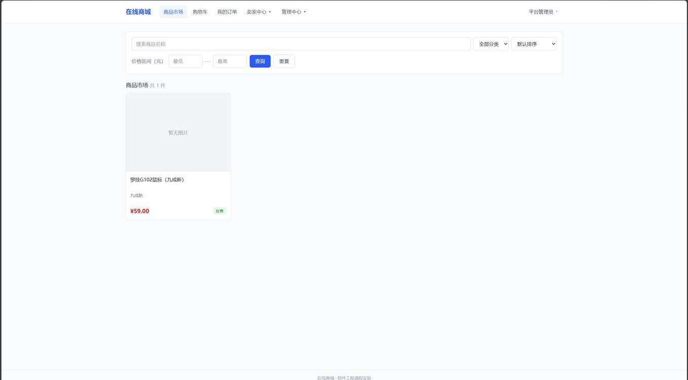
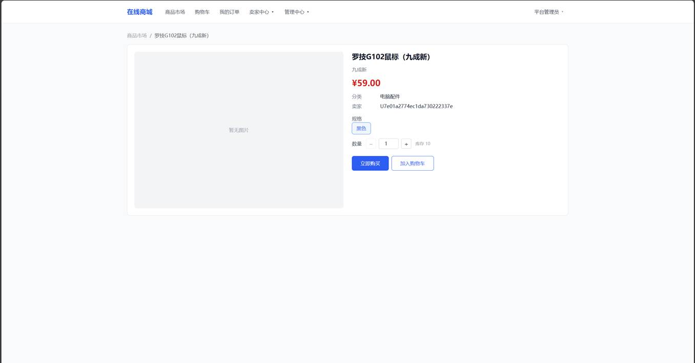
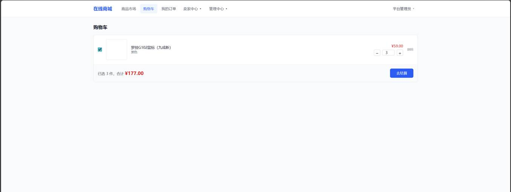
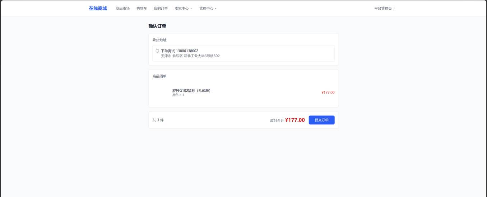
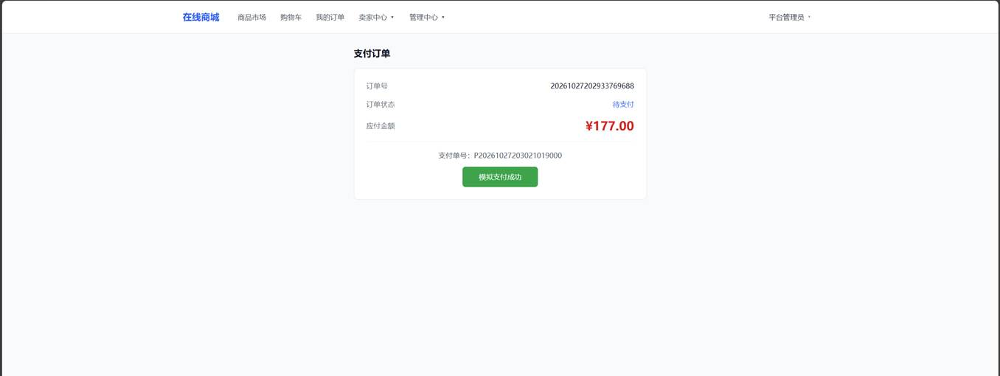
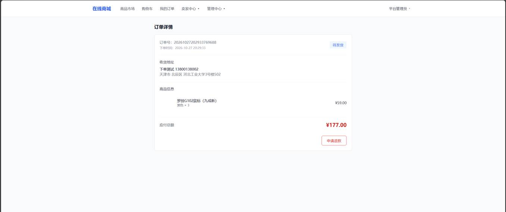
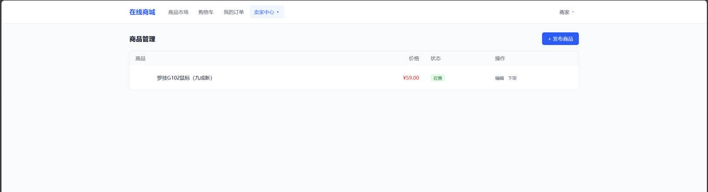
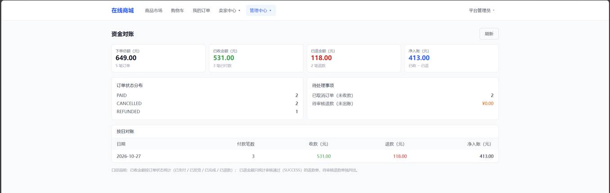
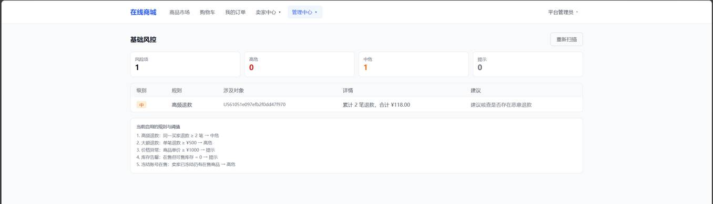

# 实验三 系统原型构建与实现

## 1. 引言

### 1.1 构建思路

本实验把实验二的设计方案落成可运行的原型。选题六要求「实现至少三个核心微服务，完成服务间联调，验证一个核心业务流程」，本项目实际完成了**五个业务服务 + 一个网关 + 一个前端**，并跑通了完整交易闭环。

构建顺序按依赖关系推进，每个阶段都要求「能跑起来」而不是「代码写完」：

| 阶段 | 内容 | 完成判据 |
| --- | --- | --- |
| 1 | 网关 + Nacos + 空服务骨架 | 服务能注册、网关能路由 |
| 2 | 用户服务：注册、登录、JWT | 能拿到令牌并访问受保护接口 |
| 3 | 商品服务：商品、SKU、库存预占 | 能查商品、能预占与释放库存 |
| 4 | 购物车服务 | 能加购、改数量、勾选 |
| 5 | 订单服务：下单、幂等、状态机、超时取消 | 能下单并看到订单 |
| 6 | 支付服务：支付单、回调、退款 | 支付后订单状态联动 |
| 7 | 前端三个角色页面 | 买家/卖家/管理员都能完成主要操作 |

### 1.2 实现范围

| 模块 | 主代码文件数 | 测试文件数 | 说明 |
| --- | --- | --- | --- |
| gateway | 6 | 1 | 路由、JWT 鉴权、跨域、异常处理 |
| user-service | 32 | 2 | 用户、地址、认证 |
| product-service | 45 | 2 | 商品、SKU、分类、库存预占 |
| cart-service | 23 | 3 | 购物车 |
| order-service | 43 | 3 | 订单、幂等、状态机、补偿 |
| payment-service | 50 | 5 | 支付、回调、退款 |
| web（前端） | 17 个页面 + 2 个组件 | — | 买家/卖家/管理员 |

**技术栈**：JDK 17、Spring Boot 3.2.5、Spring Cloud 2023.0.1、Spring Cloud Alibaba 2023.0.3.2、Nacos 2.3.2、MySQL 8.4.9、MyBatis 3.0.3、Vue 3 + Vite + Tailwind CSS 4。

---

## 2. 模块实现

### 2.1 买家端

#### 2.1.1 商品浏览与搜索



商品列表支持关键词搜索、分类筛选、价格区间、排序（默认/最新/价格升降），分页返回。

**实现在哪**：`views/ProductList.vue` 调 `GET /api/products`，网关路由到 product-service。列表只返回在售且在库的商品（BR-08），未审核、已下架、库存为零的商品不出现在买家视野里。

#### 2.1.2 商品详情



详情页展示标题、副标题、价格、分类、卖家、SKU 规格、库存，并提供「立即购买」与「加入购物车」。

**分类名的处理**：商品详情接口只返回 `categoryId`，前端额外拉一次分类列表把 ID 翻译成名称。这是开发后期发现的问题——之前一直显示「未分类」。

#### 2.1.3 购物车



购物车支持勾选、改数量、删除、失效商品置灰。同一 SKU 重复加购会累加数量。

**跨服务取数**：购物车只存 `skuId`，标题、价格、库存由 cart-service 调 product-service 补齐。这样商品改价后购物车显示的价格始终是最新的。

#### 2.1.4 确认订单



确认页展示收货地址、商品清单、应付总额，提交时生成幂等键。

**地址校验**：未选地址直接提示「请选择收货地址」，不发起请求。

#### 2.1.5 支付



支付页显示订单号、状态、金额，点击「创建支付单」后返回支付单号与「模拟支付成功」按钮。

**MOCK 渠道走完整回调流程**：不是直接把支付单改成 SUCCESS，而是构造回调报文 → 验签 → 幂等去重 → 金额核对 → 更新状态 → 通知订单。这样回调链路的逻辑才算真正被测到。

#### 2.1.6 订单详情与状态联动



支付成功后订单状态从「待支付」变为「待发货」，可申请退款。

**数据库核对**（截图为同一时刻）：

```
order_no                  status   pay_amount
20261027202933769688      PAID     17700
sku: stock_available=7  stock_locked=0     -- 原 10，卖出 3 件
```

### 2.2 卖家端

#### 2.2.1 商品管理



卖家可以查看自己的商品、编辑、上下架、发布新商品。

**数据隔离**：`GET /api/products/mine` 按当前登录用户的 `sellerId` 过滤，卖家只能看到自己的商品。

### 2.3 管理端

#### 2.3.1 资金对账



对账页按订单口径汇总下单总额、已收、已退、净入账，并给出订单状态分布与按日对账表。

**口径说明**：已收按订单状态统计（已支付/已发货/已完成/已退款），已退只统计审核通过的退款单，待审核退款单独列出，避免把「还没退的钱」算进去。

#### 2.3.2 基础风控



风控用 5 条可解释规则扫描全平台数据：高频退款、大额退款、价格异常、库存告罄、冻结账号在售。截图扫出 1 条中危——某买家累计 2 笔退款 ¥118.00。

**为什么用规则而不是模型**：规则可解释、可复现、可调阈值，答辩时能逐条讲清判断依据；黑盒模型在课程规模下既没有训练数据，也无法解释单条命中。

---

## 3. 核心代码片段

### 3.1 防超卖：条件 UPDATE

这是整个系统最关键的 SQL。把「库存是否足够」写进 `WHERE`，由数据库行锁保证原子性：

```xml
<update id="reserve">
    UPDATE sku
    SET stock_locked = stock_locked + #{quantity},
        stock_available = stock_available - #{quantity},
        version = version + 1,
        updated_at = NOW()
    WHERE sku_id = #{skuId}
      AND is_deleted = 0
      AND stock_available &gt;= #{quantity}
      AND EXISTS (
          SELECT 1 FROM product p
          WHERE p.product_id = sku.product_id
            AND p.is_deleted = 0
            AND p.status = 'ON_SALE'
      )
</update>
```

影响行数为 0 即库存不足或商品已下架，直接返回 30003。**不需要分布式锁**，也不需要「先查再扣」。

### 3.2 下单幂等：唯一键兜底

```java
try {
    idempotencyMapper.insert(OrderIdempotency.builder()
            .idemKey(key)
            .buyerId(buyerId)
            .requestHash(requestHash)
            .orderId(orderId)
            .status(IdempotencyStatus.PROCESSING)
            .build());
} catch (DataIntegrityViolationException e) {
    // 并发下另一个请求已插入，取它的结果返回
    OrderIdempotency winner = idempotencyMapper.selectByKey(key);
    return resume(winner, requestHash, buyerId);
}
```

靠 `uk_idem_key` 唯一索引去重，而不是「先 select 再 insert」——后者在并发下会两个请求同时查不到再同时插入。

### 3.3 支付回调：固定顺序

```java
// 1. 验签
if (!signatureService.verify(payload)) {
    throw new BizException(ErrorCode.CALLBACK_SIGN_INVALID, "回调验签失败");
}
// 2. 幂等去重：uk_trade_no 唯一键
try {
    callbackMapper.insert(callback);
} catch (DataIntegrityViolationException e) {
    return Result.success(null);   // 重复回调，直接返回成功
}
// 3. 金额核对
if (!payment.getAmount().equals(callbackAmount)) {
    throw new BizException(ErrorCode.CALLBACK_AMOUNT_MISMATCH, "回调金额不一致");
}
// 4. 更新支付单
// 5. 事务提交后通知订单（远程调用不进事务）
```

**顺序不能换**：先验签再谈幂等，否则伪造的回调会污染去重表；金额核对放在更新状态之前，避免「先改状态再发现金额不对」。

### 3.4 退款回补库存：状态抢占保证幂等

```sql
-- 第一步：抢状态，只有一次调用会成功
UPDATE stock_reservation SET status = 'REFUNDED'
WHERE order_id = ? AND status = 'CONFIRMED';

-- 第二步：仅当第一步影响行数 > 0 才回补
UPDATE sku SET stock_available = stock_available + #{quantity}
WHERE sku_id = ? AND is_deleted = 0;
```

如果直接「先查状态再回补」，两次并发退款会重复加库存。用条件更新抢状态，天然只有一个赢家。

### 3.5 网关白名单：带令牌也注入身份

```java
if (isWhiteListed(request.getMethod(), path)) {
    String auth = request.getHeaders().getFirst(HttpHeaders.AUTHORIZATION);
    if (auth != null && auth.startsWith("Bearer ")) {
        Claims claims = tryParse(auth.substring(7), path);
        if (claims != null) {
            return chain.filter(exchange.mutate()
                    .request(withIdentity(request, claims))
                    .build());
        }
    }
    return chain.filter(exchange);   // 无令牌按匿名放行
}
```

**为什么需要这段**：白名单接口原本「直接放行、完全不解析令牌」，导致卖家访问自己待审核的商品时，下游收到的 `userId` 是 null，被当成匿名访客拒绝。修复后白名单仍允许匿名，但带有效令牌时会注入身份。

---

## 4. 联调与问题记录

开发过程中遇到并修复的问题，按发现顺序：

| # | 现象 | 根因 | 修复 |
| --- | --- | --- | --- |
| 1 | 加购/立即购买提示「缺少 productId」 | 前端只传 `skuId`，漏了 `productId` | 补传 `productId` |
| 2 | 卖家打不开自己待审核商品的编辑页 | 白名单不解析令牌，下游拿不到身份 | 白名单带令牌时注入身份 |
| 3 | 商品详情分类一直显示「未分类」 | 接口只返回 `categoryId`，前端取 `categoryName` | 前端加分类映射 |
| 4 | 退款后库存不恢复 | payment 与 product 之间没有回补通道 | 新增回补接口 + 状态抢占 |
| 5 | 下单报「缺少请求头 X-User-Id」 | order 调 user 查地址时未传该头 | 补传请求头 |

**共同点**：这些问题代码「看起来都对」，只有真正跑起来才发现。其中 2 和 4 是链路级缺陷，单看某一层完全正常。

---

## 5. 运行验证

本地环境启动 Nacos + MySQL + 六个 JVM 进程 + 前端，跑通完整链路：

| 环节 | 结果 | 证据 |
| --- | --- | --- |
| 注册登录 | ✅ | JWT 签发与校验正常 |
| 加购 | ✅ | 购物车显示 3 件、¥177.00 |
| 下单 | ✅ | 订单 `20261027202933769688`，库存预占 |
| 支付 | ✅ | 支付单创建、MOCK 回调成功 |
| 状态联动 | ✅ | 订单 `PENDING_PAYMENT` → `PAID` |
| 库存联动 | ✅ | 可售 10 → 7，锁定归零 |
| 退款 | ✅ | 全额退款后订单 → `REFUNDED`，库存回补 |
| 角权隔离 | ✅ | 卖家只见自己的商品与退款，管理员全量 |

---

## 6. 原型访问方式

```bat
cd src\scripts
dev.bat start      :: 启动 Nacos + 六个服务
dev.bat status     :: 查看端口与注册状态
```

前端单独启动：

```powershell
cd src\web
pnpm install
pnpm dev
```

访问 http://localhost:5173 。详细步骤见《本地启动指南》。
