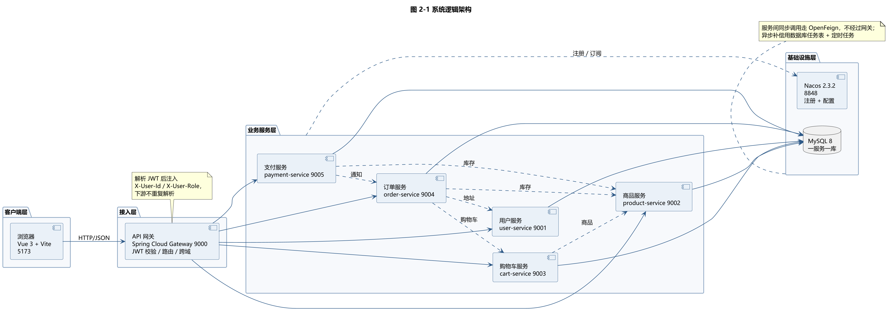
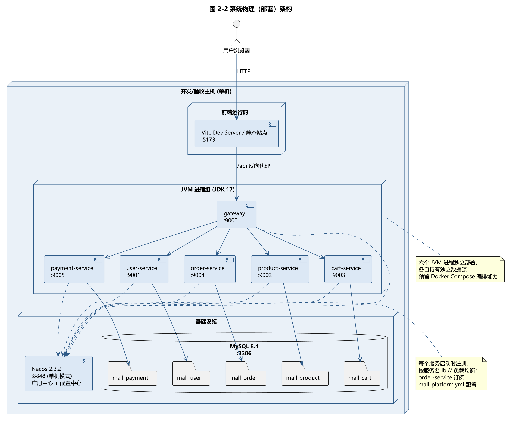
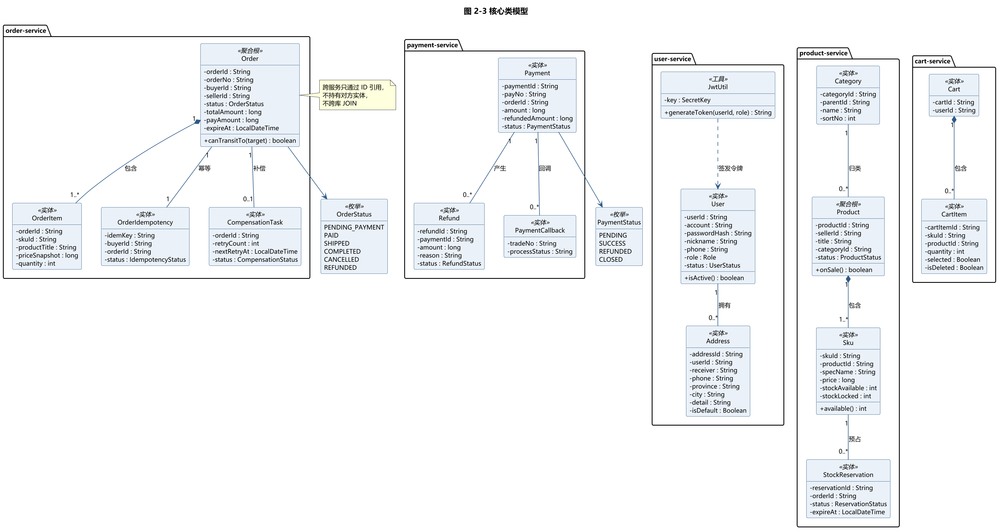
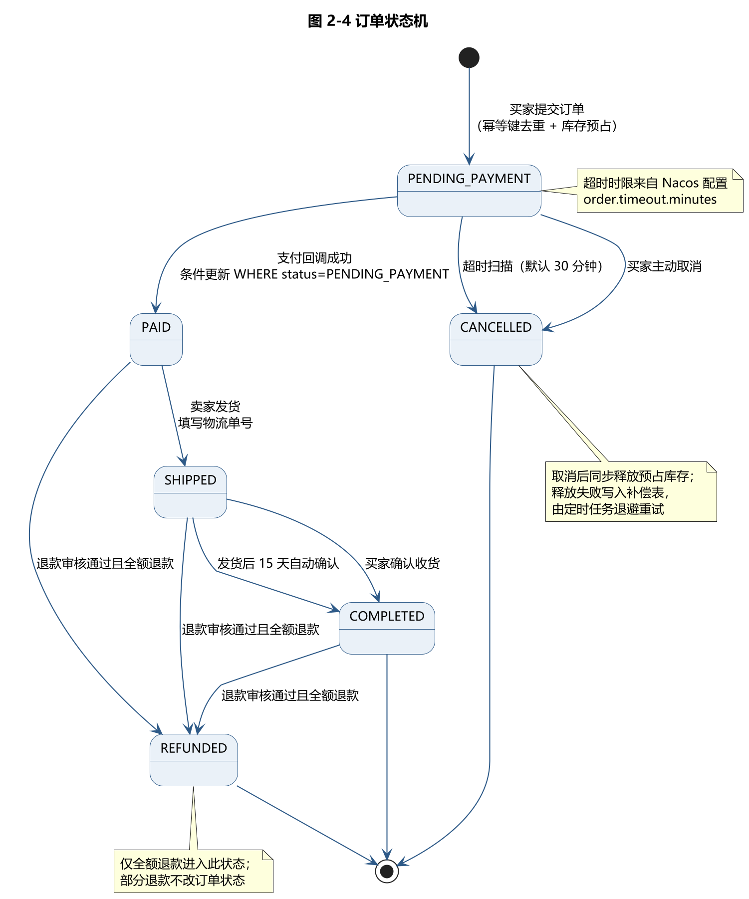
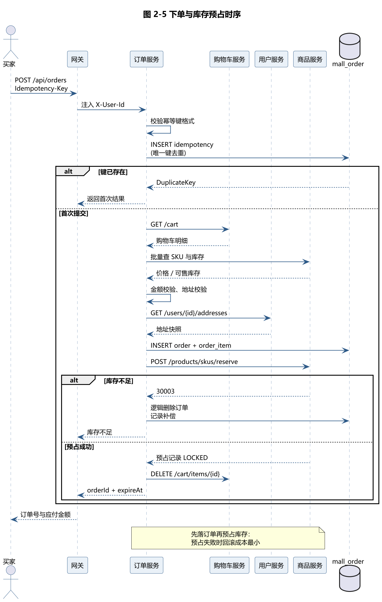

# 实验二 系统设计规格说明书

## 1. 引言

### 1.1 设计目标

本实验在实验一需求规格说明书的基础上，把「在线商城系统」的需求转化为可实施的设计方案，回答三个问题：

1. **怎么拆**：把一个电商系统拆成几个服务，每个服务负责什么，边界划在哪；
2. **怎么连**：服务之间如何调用、如何保证数据一致、出问题时如何兜底；
3. **怎么存**：需求模型怎样落到关系数据库的表结构。

设计需要同时满足实验一的非功能需求：单机 4 GB 内存可运行、核心流程响应在秒级、关键并发场景（库存超卖、重复回调、重复下单）不发生数据错误。

### 1.2 设计原则

| 原则 | 在本项目中的落地 |
| --- | --- |
| 按业务能力垂直拆分 | 用户、商品、购物车、订单、支付五个服务，各自独立部署、独立数据库 |
| 数据库私有 | 一个服务一个库，禁止跨库 JOIN，需要别的服务的数据一律调接口 |
| 单一职责 | 每个服务只管理自己的聚合根，不替别的服务改数据 |
| 契约先行 | 接口先定稿再并行开发，契约版本化（当前 v1.3） |
| 一致性靠数据库而非分布式事务 | 用条件更新、唯一键、补偿任务实现最终一致，不引入 Seata |
| 最小可用 | 不引入当前规模用不上的中间件（Redis、MQ），减少故障点 |

### 1.3 约束条件

- 开发环境：JDK 17、Spring Boot 3.2.5、Spring Cloud 2023.0.1、Nacos 2.3.2
- 数据库：MySQL 8.x，五个独立库
- 部署：单机启动六个 JVM 进程 + 前端，Docker Compose 编排为规划能力
- 团队：5 人并行开发，按服务划分负责人
- 时间：8 周 / 4 个 Sprint

---

## 2. 集体设计

### 2.1 体系结构设计

#### 2.1.1 架构风格选型

对比三种主流方案：

| 方案 | 优点 | 缺点 | 是否采用 |
| --- | --- | --- | --- |
| 单体分层架构 | 开发快、部署简单、事务天然一致 | 无法体现服务拆分；模块间耦合随规模上升；不满足选题「微服务拆分」要求 | 否 |
| 微服务架构 | 服务边界清晰、可独立部署与扩容、故障隔离 | 分布式一致性复杂、运维成本高、跨服务查询不便 | **是** |
| 服务网格（Service Mesh） | 流量治理能力强、与语言无关 | 需要额外部署 Sidecar 与 Istio，超出课程规模 | 否 |

选择微服务的原因：选题六明确要求「完成彻底的微服务拆分方案」「实现至少三个核心微服务」，微服务是硬性要求；同时课程规模（5 人、8 周）足以承担服务拆分带来的复杂度，但不足以承担服务网格的运维成本。

**关键取舍**：引入网关统一鉴权，把「JWT 解析」这件横切关注点从五个服务里抽出来，避免每个服务重复实现；但服务间调用**不经过网关**，直接走 OpenFeign + Nacos 服务发现，减少一跳延迟。

#### 2.1.2 系统逻辑架构



系统分为四层：

| 层次 | 组成 | 职责 |
| --- | --- | --- |
| 客户端层 | Vue 3 单页应用 | 买家 / 卖家 / 管理员三种角色的界面与交互 |
| 接入层 | Spring Cloud Gateway | 统一入口、JWT 校验、身份注入、路由转发、跨域处理 |
| 业务服务层 | 五个 Spring Boot 服务 | 各业务域的领域逻辑与数据管理 |
| 基础设施层 | Nacos、MySQL | 服务注册发现与配置托管、数据持久化 |

**鉴权链路**：前端只带 `Authorization: Bearer <token>`，网关解析后把 `userId` / `role` 写入 `X-User-Id` / `X-User-Role` 请求头下发给业务服务，业务服务**不再解析 JWT**。这样密钥只有网关和签发方（user-service）持有，减少泄露面。

**白名单例外**：注册、登录、支付回调、商品列表与详情、分类、图片、健康检查允许匿名访问。白名单路径若携带有效令牌，网关仍会解析并注入身份——否则卖家访问自己待审核的商品时会被当成匿名访客拒绝（这是开发中实际踩到的缺陷，见 2.4.3）。

#### 2.1.3 系统物理架构



部署形态说明：

- 六个 JVM 进程（网关 + 五服务）各自独立启动，端口 9000/9001~9005
- 五个业务库部署在同一 MySQL 实例上，但**逻辑上完全隔离**：每个服务只配自己的数据源账号与库名
- Nacos 以单机模式运行，同时承担注册中心与配置中心；order-service 订阅 `mall-platform.yml` 拿订单超时等可调参数
- 前端开发期由 Vite 代理 `/api` 到网关 9000，避免浏览器跨域
- Docker Compose 编排文件已编写但尚未验收，属规划能力

#### 2.1.4 服务拆分依据

| 服务 | 端口 | 边界依据 | 核心聚合根 |
| --- | --- | --- | --- |
| user-service | 9001 | 用户身份与档案，变化频率低，被所有服务依赖 | User、Address |
| product-service | 9002 | 商品与库存，库存是全局竞争点，必须单点管理 | Product、Sku、StockReservation |
| cart-service | 9003 | 购物车是买家私有数据，写频繁但无跨用户竞争 | Cart、CartItem |
| order-service | 9004 | 订单是交易主聚合，状态机复杂，需要与库存强协调 | Order、OrderItem |
| payment-service | 9005 | 支付对接第三方渠道，涉及验签、幂等、退款，安全要求高 | Payment、Refund |

**为什么库存放在 product-service 而不是 order-service**：库存是跨买家共享的竞争资源，如果每个订单服务实例各自扣减，必然超卖；集中在一个服务里用数据库条件更新扣减，是最简单可靠的方案。

**为什么订单和商品归同一个负责人**：库存预占、释放、确认、回补这四条链路与订单状态机强耦合（下单预占、取消释放、支付确认、退款回补），归一人负责能避免跨人协调成本，也便于在同一个分支上保证一致性。

### 2.2 模块设计

#### 2.2.1 类模型



类模型按服务分包，**跨服务只用 ID 引用，不持有对方实体**。例如订单的 `OrderItem` 只存 `skuId`、`productTitle`、`priceSnapshot`，不持有 `Sku` 对象——商品改名或改价不影响历史订单，这是「快照」设计的直接收益。

主要类的职责：

| 类 | 职责 | 关键约束 |
| --- | --- | --- |
| `User` | 账号、口令哈希、角色、状态 | 账号与昵称全局唯一；口令 BCrypt 加盐 |
| `Product` / `Sku` | 商品与规格，含可售/锁定双库存字段 | 上架需审核通过；库存扣减走条件更新 |
| `StockReservation` | 记录一笔订单对某 SKU 的预占 | 状态机 LOCKED → CONFIRMED / RELEASED / REFUNDED |
| `Cart` / `CartItem` | 买家购物车 | 同 SKU 累加；失效商品保留但置灰 |
| `Order` / `OrderItem` | 订单主表与明细快照 | 状态机六态；金额与地址均快照 |
| `OrderIdempotency` | 下单幂等令牌 | `idem_key` 唯一索引 |
| `CompensationTask` | 库存释放失败后的补偿任务 | 指数退避，最多 8 次，超限转 DEAD |
| `Payment` / `Refund` | 支付单与退款单 | `refunded_amount` 条件更新防止超额退款 |
| `PaymentCallback` | 支付回调流水 | `trade_no` 唯一索引做去重 |

#### 2.2.2 关键设计逻辑

**（1）订单状态机**



状态流转全部用「带原状态的条件更新」实现：

```sql
UPDATE `order` SET status = 'PAID', paid_at = NOW()
WHERE order_id = ? AND status = 'PENDING_PAYMENT'
```

影响行数为 0 说明状态已被并发修改，本轮放弃，不覆盖。这样既避免了分布式锁，也不会出现「已取消订单被支付回调复活」的错误。

**（2）下单与库存预占**



执行顺序是设计重点，**先落订单再预占库存**：

1. 校验幂等键，`idempotency` 表唯一索引去重（并发下靠 `DuplicateKeyException` 兜底，不做「先查再插」）
2. 调 cart-service 取购物车明细，调 product-service 校验 SKU 与库存
3. 校验收货地址，写入订单主表与明细快照
4. 调 product-service 预占库存；预占失败则逻辑删除订单并回滚
5. 预占成功后清理购物车对应条目

先落订单的理由：如果先预占库存再建订单，建订单失败时要回滚库存，链更长；先建订单，失败时只需删除一条订单记录，回滚成本最小。

**（3）库存预占的并发控制**

```sql
UPDATE sku
SET stock_locked = stock_locked + #{quantity},
    stock_available = stock_available - #{quantity}
WHERE sku_id = #{skuId}
  AND stock_available >= #{quantity}
```

条件 `stock_available >= quantity` 写在 SQL 里，由数据库行锁保证原子性，影响行数为 0 即库存不足。这条 SQL 是整个系统防超卖的核心，不需要任何分布式锁。

**（4）支付回调处理顺序**

固定顺序，任何一步失败都不继续：

1. 验签（失败返回 60002，不改任何状态）
2. 幂等去重（`payment_callback` 表 `uk_trade_no` 唯一键，冲突即重复回调，直接返回成功）
3. 查支付单与订单（不存在返回 60001）
4. 金额核对（不一致返回 60003，不改订单）
5. 更新支付单为 SUCCESS
6. 事务提交后通知 order-service 置为已支付

**远程调用放在事务提交之后**是关键：如果在事务内调 Feign，远程耗时会一直占着数据库连接，而且远程调用不走本地事务、回滚不了。

**（5）退款与库存回补**

退款成功后需要把已扣减的库存加回可售数量。这条链路在开发后期才补齐，实现要点：

- 只有**全额退款**才回补库存并通知订单变更状态；部分退款不改订单状态，也不回补
- 回补的幂等由预占状态机保证：条件更新把预占从 `CONFIRMED` 抢改为 `REFUNDED`，只有改成功的那次才真的加库存
- 远程调用失败只记日志不阻断退款结果，避免退款卡在库存服务上

#### 2.2.3 一致性方案汇总

| 场景 | 手段 | 代码位置 |
| --- | --- | --- |
| 库存超卖 | 条件 UPDATE（`stock_available >= quantity`） | `SkuMapper.reserve` |
| 重复下单 | `order_idempotency` 表 `idem_key` 唯一索引 | `OrderService.create` |
| 重复支付回调 | `payment_callback` 表 `uk_trade_no` 唯一索引 | `CallbackTxService` |
| 状态并发修改 | 带原状态的条件 UPDATE | `OrderMapper.markPaid/markCancelled/markRefunded` |
| 超额退款 | `payment.refunded_amount` 条件更新预占额度 | `RefundServiceImpl` |
| 库存释放失败 | 补偿表 + 定时任务指数退避重试 | `CompensationService`、`OrderTimeoutJob` |
| 预占永久锁定 | 定时扫描过期 LOCKED 预占并释放 | `StockService.releaseExpiredReservations` |

**为什么不用分布式事务（Seata）**：五个服务各自单库，跨服务的一致性都能用「本地事务 + 条件更新 + 补偿」表达；引入 Seata 需要额外部署 TC 服务、增加两阶段提交延迟，而收益仅是省掉补偿代码——对本项目的规模不划算。

---

## 3. 数据库设计

### 3.1 数据库设计策略

**一服务一库**：`mall_user`、`mall_product`、`mall_cart`、`mall_order`、`mall_payment` 五个独立库，共 17 张表。

设计要点：

1. **主键用字符串而非自增**：订单号、商品号等对外 ID 用 `String`，防止被枚举；内部表（如 `config_audit`）可用自增
2. **金额用 `bigint` 存分**：避免浮点误差，`10050` 表示 100.50 元
3. **快照而非外键**：订单明细存 `product_title`、`price_snapshot`，商品改价改名不影响历史订单
4. **逻辑删除**：`is_deleted` 字段，避免物理删除破坏历史关联
5. **乐观版本号**：`version` 字段用于个别需要版本比对的场景
6. **时间统一** `datetime`，约定北京时间

### 3.2 数据库表清单

| 序号 | 所属库 | 表名 | 中文名 | 字段数 |
| --- | --- | --- | --- | --- |
| 1 | mall_user | user | 用户表 | 13 |
| 2 | mall_user | address | 收货地址表 | 12 |
| 3 | mall_product | category | 商品分类表 | 5 |
| 4 | mall_product | product | 商品表 | 13 |
| 5 | mall_product | sku | 商品规格表 | 10 |
| 6 | mall_product | stock_reservation | 库存预占表 | 6 |
| 7 | mall_product | stock_reservation_item | 预占明细表 | 4 |
| 8 | mall_cart | cart | 购物车表 | 7 |
| 9 | mall_cart | cart_item | 购物车条目表 | 12 |
| 10 | mall_order | order | 订单主表 | 19 |
| 11 | mall_order | order_item | 订单明细表 | 13 |
| 12 | mall_order | order_idempotency | 下单幂等表 | 8 |
| 13 | mall_order | order_compensation | 补偿任务表 | 8 |
| 14 | mall_order | config_audit | 配置变更留痕表 | 7 |
| 15 | mall_payment | payment | 支付单表 | 15 |
| 16 | mall_payment | payment_callback | 支付回调流水表 | 9 |
| 17 | mall_payment | refund | 退款单表 | 15 |

### 3.3 关键表结构

#### 3.3.1 订单主表 `mall_order.order`

| 字段名 | 类型 | 允许空 | 默认值 | 说明 |
| --- | --- | --- | --- | --- |
| order_id | varchar(32) | 否 | — | 订单 ID（主键） |
| order_no | varchar(32) | 否 | — | 对外订单号（唯一） |
| buyer_id | varchar(32) | 否 | — | 买家 ID |
| seller_id | varchar(32) | 否 | — | 卖家 ID |
| status | varchar(24) | 否 | — | 订单状态（六态） |
| total_amount | bigint | 否 | — | 商品总额（分） |
| pay_amount | bigint | 否 | — | 应付金额（分） |
| receiver | varchar(32) | 否 | — | 收货人快照 |
| receiver_phone | varchar(11) | 否 | — | 联系电话快照 |
| address_full | varchar(255) | 否 | — | 完整地址快照 |
| tracking_no | varchar(64) | 是 | NULL | 物流单号 |
| expire_at | datetime | 否 | — | 支付截止时间 |
| paid_at | datetime | 是 | NULL | 支付时间 |
| inventory_released | tinyint(1) | 否 | 0 | 库存是否已释放 |

**索引**：`PRIMARY KEY (order_id)`、`UNIQUE KEY uk_order_no (order_no)`、`KEY idx_buyer (buyer_id, status)`、`KEY idx_status_expire (status, expire_at)`。

`idx_status_expire` 支撑超时扫描：`WHERE status='PENDING_PAYMENT' AND expire_at <= ?`。

#### 3.3.2 商品规格表 `mall_product.sku`

| 字段名 | 类型 | 允许空 | 默认值 | 说明 |
| --- | --- | --- | --- | --- |
| sku_id | varchar(32) | 否 | — | 规格 ID（主键） |
| product_id | varchar(32) | 否 | — | 所属商品 |
| spec_name | varchar(64) | 否 | — | 规格名（如「黑色」） |
| price | bigint | 否 | — | 单价（分） |
| stock_available | int | 否 | 0 | 可售库存 |
| stock_locked | int | 否 | 0 | 锁定库存 |
| version | int | 否 | 0 | 乐观锁版本 |

**双库存字段设计**：`stock_available` 是买家可下单的量，`stock_locked` 是已下单未支付占用的量。下单时两者一增一减，支付成功后锁定转为真实扣减（`stock_locked` 减），取消或超时则锁定退回可售。这样「可售」与「已占用」始终分离，不会出现「看起来有货但实际已被别人占了」的超卖。

**唯一约束**：`UNIQUE KEY uk_product_spec (product_id, spec_name)`，防止同一商品出现重复规格。

#### 3.3.3 支付单表 `mall_payment.payment`

| 字段名 | 类型 | 允许空 | 默认值 | 说明 |
| --- | --- | --- | --- | --- |
| payment_id | varchar(32) | 否 | — | 支付单 ID（主键） |
| pay_no | varchar(32) | 否 | — | 对外支付号（唯一） |
| order_id | varchar(32) | 否 | — | 关联订单 |
| amount | bigint | 否 | — | 应付金额（分） |
| refunded_amount | bigint | 否 | 0 | 已退金额（分） |
| status | varchar(16) | 否 | — | 支付状态 |
| paid_at | datetime | 是 | NULL | 支付成功时间 |

**`refunded_amount` 的作用**：退款时用条件更新预占额度

```sql
UPDATE payment SET refunded_amount = refunded_amount + ?
WHERE payment_id = ? AND refunded_amount + ? <= amount
```

影响行数为 0 即超额退款，直接返回 60004。这样多笔退款并发时也不会退超过实付金额。

#### 3.3.4 预占状态机与退款回补

`stock_reservation.status` 取值：

| 值 | 含义 |
| --- | --- |
| LOCKED | 已预占，等待支付 |
| CONFIRMED | 支付成功，已转为真实扣减 |
| RELEASED | 超时或取消，库存已退回可售 |
| REFUNDED | 退款成功，已扣减的库存已回补 |

退款回补的幂等实现：

```sql
-- 第一步：抢占状态，只有这次调用会回补
UPDATE stock_reservation SET status = 'REFUNDED'
WHERE order_id = ? AND status = 'CONFIRMED';

-- 第二步：仅当第一步影响行数 > 0 时，按明细回补
UPDATE sku SET stock_available = stock_available + ?
WHERE sku_id = ? AND is_deleted = 0;
```

### 3.4 表间关系

```
mall_user:    user 1 ──< address
mall_product: category 1 ──< product 1 ──< sku 1 ──< stock_reservation_item
                                                    stock_reservation >── order_id（跨库，仅存 ID）
mall_cart:    cart 1 ──< cart_item  （sku_id / product_id 跨库引用）
mall_order:   order 1 ──< order_item
              order 1 ──1 order_idempotency
              order 1 ──0..1 order_compensation
mall_payment: payment 1 ──< refund
              payment 1 ──< payment_callback
```

**跨库不建外键**：所有跨服务关联只存 ID，靠应用层校验。这是微服务「数据库私有」原则的直接体现——如果建了跨库外键，两个库就无法独立迁移与扩容。

### 3.5 与需求模型的对应

| 实验一域模型中的概念 | 落地表 |
| --- | --- |
| 用户、地址 | `user`、`address` |
| 商品、规格、分类 | `product`、`sku`、`category` |
| 库存预占 | `stock_reservation`、`stock_reservation_item` |
| 购物车、条目 | `cart`、`cart_item` |
| 订单、订单明细 | `order`、`order_item` |
| 幂等令牌、补偿任务 | `order_idempotency`、`order_compensation` |
| 支付单、退款单、回调流水 | `payment`、`refund`、`payment_callback` |
| 平台配置变更 | `config_audit` |

---

## 4. 参考资料

1. 河北工业大学《软件工程实验》（2026 版）实验指导书
2. 项目《05-接口契约》v1.3
3. 项目《06-开发规范》
4. Spring Boot 3.2 / Spring Cloud 2023 官方文档
5. Nacos 2.3 官方文档
