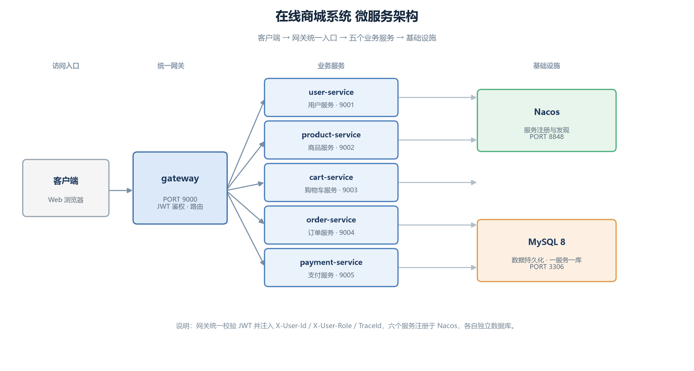
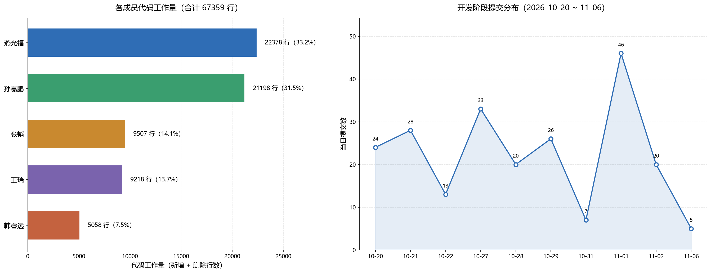

# 第五部分 实验总结

## 1. 小组实验总结

### 1.1 完成情况与预期对比

八个周的实验周期内，我们完成了一个可运行的云原生在线商城系统。对比实验一规划的目标：

| 规划目标 | 预期 | 实际达成 | 差距 |
| --- | --- | --- | --- |
| 服务拆分 | 五个业务服务 | 五个业务服务 + 网关 | 达成 |
| 核心流程 | 下单→支付→发货→收货 | 全链路跑通：接口层（`main@81610d3`）与**浏览器页面级点击流程**（2026-11-06，注册→加购→结算→提交订单→支付→订单状态联动）均完成 | 达成 |
| 并发正确性 | 不超卖、不重复扣款 | 对应并发用例在 **H2 隔离库 + Mock 下游**环境下通过（`main@81610d3`，2026-11-02）；**部署环境下的并发行为与全局库存一致性未验证** | 待定（取决于指导书对「并发正确性」的具体验收口径；单测层通过不等于部署运行层已验） |
| 容器化 | Docker Compose 一键起 | **已验证**：8 容器一键起全栈，服务全部注册 Nacos | 达成 |
| 压力测试 | 简单压测验证可扩展性 | **已补做**：Docker Compose 全栈环境用 curl 并发压测，六个只读场景，P95 19~101 ms，表中「错误数」列六行均为 0（未独立复算）（数据见实验四 §4.2.1 表 4-18 与图 4-4）；**写路径吞吐未测** | 达成（只读接口范围） |
| 报告 | 五部分 | 五部分成稿（第五部分已按 2026-11-10 用户确认的回传材料同步） | 达成 |

> **关于「达成」的口径**：上表「达成」仅指该行所述范围内的工作已完成，**不等于整个实验达标**。压力测试一项的达成范围**仅限只读接口**，写路径（下单、支付）吞吐未测；故障注入、可观测性两项未做。不以上表中「达成」字样掩盖上述欠项。

**明确没做到的**：写路径压测与故障注入。

压力测试已补做，但**只覆盖六个只读压测场景（涉及四类接口：商品列表、商品详情、购物车查询、类别树）**，压测方法为 Docker Compose 全栈环境下用 curl 并发发起请求、记录每次耗时、汇总计算 P50/P95/P99；并发由 10 提升到 50 时 P95 约增长到 4 倍，表中「错误数」列六行均为 0。数据见表 4-18 与图 4-4（见实验四 §4.2.1）。

**没做到的部分**：下单、支付等**写路径在高并发下的吞吐未测**；也未做长时间稳定性压测（每轮仅 200~500 次请求、持续数十秒）。

故障注入未做：失败时的补偿与降级逻辑已实现，但没有故障场景下的验证记录。

这两项都写在实验四的遗留问题里，属于已知缺口，不做措辞弱化。

### 1.2 做得好的地方

**（1）把「看起来对」和「真的能跑」分开了**

项目里最有价值的发现，都是代码看起来完全正确、单元测试也通过，但实际跑起来才暴露的问题：

- 网关白名单「直接放行」导致卖家打不开自己待审核的商品——因为令牌根本没被解析，下游拿到的 userId 是 null
- 退款成功后库存一直不恢复——payment 和 product 之间根本没有回补通道
- 并发取消时库存被释放两次——`markCancelled` 返回 0 后代码仍然继续调用释放
- 库存预警服务起不来——`ALTER TABLE ... ADD COLUMN IF NOT EXISTS` 是 MariaDB 语法，MySQL 不认

这四个问题的共同点是：**看代码找不到，必须构造真实场景**。这也是我们后来坚持「每个修复都要有能复现的测试」的原因。

**（2）契约先行真的省了返工**

五个服务并行开发，接口契约先定稿（迭代到 v1.7），每个人按契约写自己的部分。联调时大部分接口直接能用，返工主要集中在契约本身没写清的地方（如加购要不要传 productId）。

**（3）一致性方案选得克制**

没有引入 Seata，也没有用分布式锁。库存扣减用一条带条件的 UPDATE，幂等靠数据库唯一键，状态流转用带原状态的 CAS，失败补偿用任务表 + 定时任务。这套方案在课程规模下足够，而且每个机制都能讲清原理，不像引入中间件那样「配好了但说不明白」。

**（4）跨服务状态只留一个真相**

第二轮做店铺停用时，最省事的做法是在商品表上加一个「店铺是否营业」字段，每次查商品时连表判断。我们没那么做，而是只让 `shop.status` 一处存营业状态，商品侧靠同步改状态、下单侧靠 `shopActive` 兜底。代价是同步失败要回滚店铺状态，好处是不会出现「店铺已停用但商品还在卖」这种两处状态打架的情况。

**（5）如实标注没做到的部分**

真实压测与故障注入两项没完成，可观测性也未接入，这些在报告里逐条写进了遗留问题，没有用「已规划」「理论上支持」搪塞。容器化部署起初也列在未完成里，后来真正跑通 `docker compose up` 才改成已验证——这个顺序说明我们没有把「写了配置文件」当成「部署成功」。能明确说出边界在哪，比含糊地说「都做了」更可信。

### 1.3 做得不够的地方

**（1）前期对「跑起来」的重视不够**

前几个迭代基本是「代码写完就算完成」，直到联调阶段才发现问题集中在跨服务调用上。如果每个迭代结束都完整跑一遍链路，问题会更早暴露。

**（2）测试覆盖不均衡**

payment-service 26 个用例、cart-service 20 个，而 gateway 只有 9 个、user-service 只有 6 个。鉴权这类安全边界其实最该多测。

**（3）文档同步滞后**

文档一度落后于实现——契约里写的 Redis 队列和分布式锁从未落地，README 里的目录结构缺了三个服务。这些都是后期集中补救的。

### 1.4 团队协作

| 成员 | Issue 数 | 主要贡献 | 代码量 |
| --- | --- | --- | --- |
| 燕光福（组长） | 8 | 网关、Nacos、接口契约、设计报告、集成与联调、修复跨服务缺陷 | +18429 |
| 王瑞 | 5 | 商品服务、订单服务（含库存预占、幂等、状态机、超时取消）、并发测试 | +6428 |
| 孙嘉鹏（sun/si1oo） | 4 | 用户服务、前端商城化改造 | +5632 |
| 张韬（Nolset886） | 3 | 支付服务（支付单、回调验签、幂等、退款） | +3474 |
| 韩睿远（fgwew053-byte） | 3 | 购物车服务 | +1912 |

全项目 **219 次提交**（其中 159 次为功能提交，其余为 PR 合并提交），自 2026-10-20 建立仓库起至 2026-11-06 交付收尾。按服务划分负责人，每人只改自己负责的目录。跨目录改动先在 Issue 里说明，避免互相覆盖。

### 1.5 如果重来一次

1. **每个迭代结束必须完整跑一遍链路**，而不是等到最后联调
2. **测试跟着功能走**，不留到最后补
3. **文档和代码同一次提交**，避免文档漂移
4. **联调环境早点搭**，别等到所有人代码写完才发现环境问题

---

## 2. 成员个人实验总结

材料来源：2026-11-10 回传的成员材料 Excel。姓名、总结及评分经用户统一核对确认后采用；个人总结保留回传原文。

### 2.1 燕光福（组长）

作为组长，我主要承担 gateway 网关搭建、Nacos 服务治理、接口契约维护（迭代到 v1.7）以及跨服务集成联调。整个系统拆成 6 个微服务加前端，看似职责分明，但一到集成阶段，底层环境不一致与并发边界问题全部暴露出来。

最典型的事故发生在容器化阶段。在 product-service 增加低库存预警功能时，schema.sql 里顺手写了 ALTER TABLE ... ADD COLUMN IF NOT EXISTS。本地单测跑 H2 内存库完全正常，但打成 Docker 镜像、拉起真实 MySQL 8 容器时服务直接挂掉——这是 MariaDB 的扩展语法，MySQL 8 不支持。内存库测试通过并不等于生产环境就绪。

更棘手的是 Issue #74 的高并发重复扣库存：H2 在事务回滚后复用主键自增序列，掩盖了并发冲突；业务层 createFresh 提交事务与 Feign 预占之间存在毫秒级竞态窗口，并发重试误判状态，补发了第二次预占。最后引入 RESERVING 中间状态配合 CAS 抢占权控制才闭环。网关白名单也栽过跟头——直接放行卖家接口导致 JWT 未被解析，下游拿到 null userId。这次集成排查累计处理 8 个核心 Issue、提交代码超 1.8 万行，彻底磨平了我对微服务「表面解耦、隐式依赖」的认知盲区。

### 2.2 王瑞

一、 商品与订单核心服务研发
商品服务中，我设计了可用与锁定库存双字段模型，摒弃复杂的分布式锁，直接采用数据库带条件的原子更新，在底层杜绝了并发超卖；订单服务中，我梳理并实现了严格的订单状态流转，采用带原状态校验的 CAS 条件更新与幂等表去重，打通了创单预占、支付回执、超时取消与库存释放的完整闭环。
二、 并发测试与核心竞态缺陷攻坚
依托 JUnit 5 与 CountDownLatch 构建了多线程并发测试矩阵。通过 100/500 并发预占用例，实测验证了库存精准扣至零且无超卖；针对关键缺陷（Issue #48 / #74），深挖并定位出买家手动取消与定时超时取消并发时触发的“库存二次释放”漏洞，引入 RESERVING 抢占态与防重释放标记，彻底解决了竞态死锁与重复预占；同时验证了 50 线程同幂等键并发创单的唯一性，确保了订单数据的一致性。
三、 管理端及商品详情 UI 规范改造
主导完成了管理端全量 10 个页面及买家侧 ProductDetail.vue向 Element Plus 2.14 的迁移。重构中严格遵守公共合同规范，统一使用行内表单筛选与标准表格，关键敏感操作强制接入 confirmAction 二次确认与行级 Loading。
本次实践贯穿了“微服务状态机设计—数据库并发一致性—前端工业化组件重塑”全链路，不仅锤炼了底层高并发安全把控能力，也深化了敏捷团队接口契约与代码规范意识。

### 2.3 孙嘉鹏

我负责 user-service 的实现，以及整个前端的商城化改造和卖家端 6 个页面的重构（PR #92）。原工程是个二手闲置交易系统，改成正规 B2C 商城，前端几乎等于推倒重来。

那段时间改动量极大，二十多个页面连续重构，尤其商品多规格（SKU）动态表单联动和上下架校验，数据结构嵌套深，前后调了两整天才把双向绑定和规格矩阵算对。商品编辑页踩了个大坑：我在保存接口后跟了 loadProduct() 刷新详情，但后端规则是「商品被修改就打回 PENDING 待审核」，而详情接口对非在售商品直接报错，结果保存成功却弹出「加载失败」把成功提示盖掉。

分类树也坑了一整天，后端返回无序导致子分类排到父类前面，最后靠后端按 level 排序、前端递归缩进才理顺。user-service 那边 PUT /api/users/{id}/role 传错参数直接吐 500，完全没法排查。前后端契约一旦有模糊，最遭殃的就是写 UI 的人。

### 2.4 张韬

我负责 payment-service 的全生命周期，涵盖支付单流转、回调验签、幂等控制、退款与售后，同时承担买家端 8 个核心交易页面的 Element Plus 改造（PR #101）。

支付回调我卡死了处理顺序：先无条件验签，再查幂等，接着核对金额，最后才推状态机。讨论过把查幂等前置以省验签开销，我坚持反对——未验签就写幂等去重表，攻击者可以用伪造回调把表打满，真实支付通知反倒被当重复消息丢弃，造成掉单。

退款没有用 Redis 全局互斥锁，而是在 RefundMapper 用 WHERE refunded_amount + ? <= amount 的行级条件更新，把防超退压在数据库层。买家端改造后组长抓出我 3 处交互偏差：AfterSales 误加了「支付单必须 SUCCESS 才显示可退金额」，未付款时输入框露出来却看不见金额；OrderDetail 上传评价图没做总量限制，选 8 张会先传 3 张再拦截。后期还出过一次 payment 表缺 reconciled_at 列导致对账报错的事故。金融级业务容不得任何理所当然的侥幸。

### 2.5 韩睿远

我负责 cart-service，后期增补了内部接口鉴权、商品评价、操作审计日志模块，并完成账户中心 4 个页面的 Element Plus 改造（PR #105）。

购物车看着单薄，深挖全是边界：同一 SKU 多次加购必须累加数量而不是生成两行；商品下架或店铺被停用时不能物理 DELETE，否则买家刷新东西凭空消失，必须跨服务实时核验并标记失效置灰；价格不能在加购时固化，结算必须动态拉最新定价。

排查 Issue #56 时发现 order-service 下单扣减购物车直接调了公开接口，网关剥离前缀后底层无法区分这是网关转发还是内部 Feign 调用，存在安全绕过隐患。我重构为 /internal/cart/** 并强制核验 X-Internal-Token。做账户页时还踩了个运行时坑：局域网 IP 访问属于非安全上下文，crypto.randomUUID() 返回 undefined，导致防重提交令牌报错、按钮静默无反应，最后用全局守卫加随机数兜底解决。微服务的稳定正是建立在对这些边缘漏洞的严防死守上。

## 3. 组内互评

### 3.1 评分说明

四个评价维度各满分 25 分，总分满分 100 分。每人接受另外四人的评分；表中四维分数为所收评分的均值，贡献系数＝个人平均总分÷五人平均总分。

评分来源：采用用户统一核对确认的 Excel 分配结果。评分按指定比例生成后经统一确认，不描述为独立、匿名收集的评价。

### 3.2 互评汇总表

| 成员 | 工作态度 | 系统设计 | 系统实现 | 系统测试 | 合计 | 贡献系数 |
| --- | --- | --- | --- | --- | --- | --- |
| 燕光福 | 24 | 24 | 24 | 24 | 96 | 1.2 |
| 王瑞 | 22 | 22 | 22 | 22 | 88 | 1.1 |
| 孙嘉鹏 | 18 | 18 | 18 | 18 | 72 | 0.9 |
| 张韬 | 18 | 18 | 18 | 18 | 72 | 0.9 |
| 韩睿远 | 18 | 18 | 18 | 18 | 72 | 0.9 |

五人平均总分为 80；贡献系数合计为 5.0、平均为 1.0。燕光福的系数为 1.2，表示其平均总分为全组平均值的 1.2 倍。

### 3.3 评分来源与确认

本次回传文件的 20 条理由均为“按指定比例生成，非独立评分；请本人核对”。本报告保留该来源事实，不另行补写成员个人评价；用户已于 2026-11-10 统一确认采用文件中的评分结果。

---

## 4. AI 使用记录

### 4.1 使用了什么工具

全程使用 **DeepSeek Harness（DSH）**，一个可以操作文件系统与终端的通用智能体。相比 GitHub Copilot 这类补全型工具，它能读取整个仓库、执行命令、跑测试、上传代码，能力范围更宽。

### 4.2 在哪些环节使用

| 环节 | 具体用途 | 人工做了什么 |
| --- | --- | --- |
| 需求分析 | 行业数据检索、用例结构梳理、用户故事地图框架 | 核对数据来源、调整用例粒度、补充业务规则 |
| UML 建模 | 生成 PlantUML 源文件初稿（用例图、活动图、域模型、类图、状态图、时序图） | 逐张核对语义、修正关系方向、调整布局 |
| 接口契约 | 起草接口定义、错误码表、数据结构 | 逐字段审核，按实现反馈修订，版本化管理 |
| 后端开发 | 各服务的骨架代码、Mapper、DTO、Service 逻辑 | 审查业务逻辑、补充并发处理、修复缺陷 |
| 前端开发 | 页面骨架、组件、API 调用 | 调整交互细节、修复状态管理问题 |
| 测试 | 生成测试用例、并发测试脚本 | 补充边界场景，判断失败是环境问题还是真实缺陷 |
| 文档排版 | Markdown 转 docx、图表题编号、三线表、页码 | 检查排版效果、调整格式规范 |
| 缺陷定位 | 分析日志、跨服务排查、给出修复方案 | 判断根因、决定修复方案、验证修复效果 |

### 4.3 给 AI 的关键提示

举几个典型的：

- **「按指导书第二部分的结构写设计文档」**——把指导书的章节要求直接给它，避免自由发挥
- **「这个缺陷必须构造能复现的测试再修」**——防止它改代码但不验证
- **「不确定的地方标注出来，不要编造」**——这条最重要，避免它生成看起来合理但实际不存在的内容
- **「跨服务改动先在 Issue 里说明」**——约束它不要擅自改别人负责的目录

### 4.4 AI 生成内容的处理

| 处理方式 | 比例 | 说明 |
| --- | --- | --- |
| 直接采用 | 约 30% | 主要是样板代码、DTO、Mapper XML、文档排版脚本 |
| 修改后采用 | 约 60% | 业务逻辑、测试用例、文档表述，都需要按项目实际情况调整 |
| 弃用重写 | 约 10% | 方案不合理或偏离需求的部分，比如最初建议用 Redis 做分布式锁，实际用数据库条件更新更合适 |

**典型的需要修正的例子**：

- AI 生成的 `schema.sql` 用了 `ALTER TABLE ... ADD COLUMN IF NOT EXISTS`，MySQL 不支持，导致服务起不来
- AI 写的契约里包含 Redis 队列和分布式锁，但实现时根本没用到，文档一度和代码对不上
- AI 生成的图表在 docx 里丢了图题，需要额外写脚本补

### 4.5 对效率的影响

| 方面 | 变化 |
| --- | --- |
| 编码速度 | 骨架代码和样板代码快很多，估计节省 40% 以上时间 |
| 文档撰写 | 效率提升明显，尤其是格式化的重复劳动 |
| 调试 | **不一定更快**——AI 有时会给出看似合理但错误的判断，需要自己验证 |
| 学习曲线 | 对不熟悉的技术栈（Spring Cloud Alibaba），AI 能快速给出可运行的示例 |

### 4.6 教训与下次调整

**最大的教训：AI 的输出必须验证，而且要用「真实环境」验证。**

库存预警那次，单元测试全绿，但服务根本起不来——因为测试用 H2，生产用 MySQL，两者对同一条 SQL 的支持不同。这让我明白：**AI 能写出「测试通过」的代码，但保证不了「系统能跑」**。

下次会这样调整：

1. **每个功能完成后必须真实启动验证**，不能只看单测
2. **让 AI 修改关键配置或 schema 时，要求它同时给出验证方法**
3. **报告里的每个数据都要能追溯到来源**，AI 生成的内容也一样
4. **保留 AI 使用记录**，把「哪些是 AI 写的、哪些人工改了」记清楚，这既是课程要求，也是自己复盘的需要

### 4.7 关于「AI 生成的代码算不算自己的」

这个问题我们讨论过。我的理解是：AI 像一个写代码很快但不熟悉业务的协作者，它不知道我们的库存字段为什么设计成双字段、不知道为什么支付回调的顺序不能换。这些判断必须由人来做。

所以更准确的说法是：**AI 负责打字，人负责决策**。报告里每个设计决策我们都写明了「为什么这么做」，如果只是 AI 生成的，我们说不出来。
