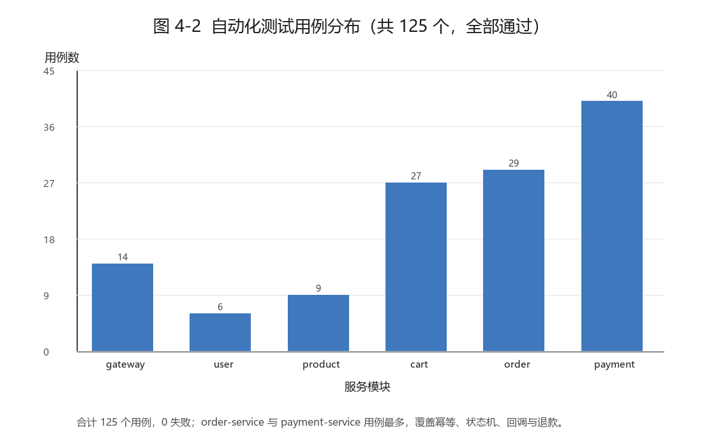
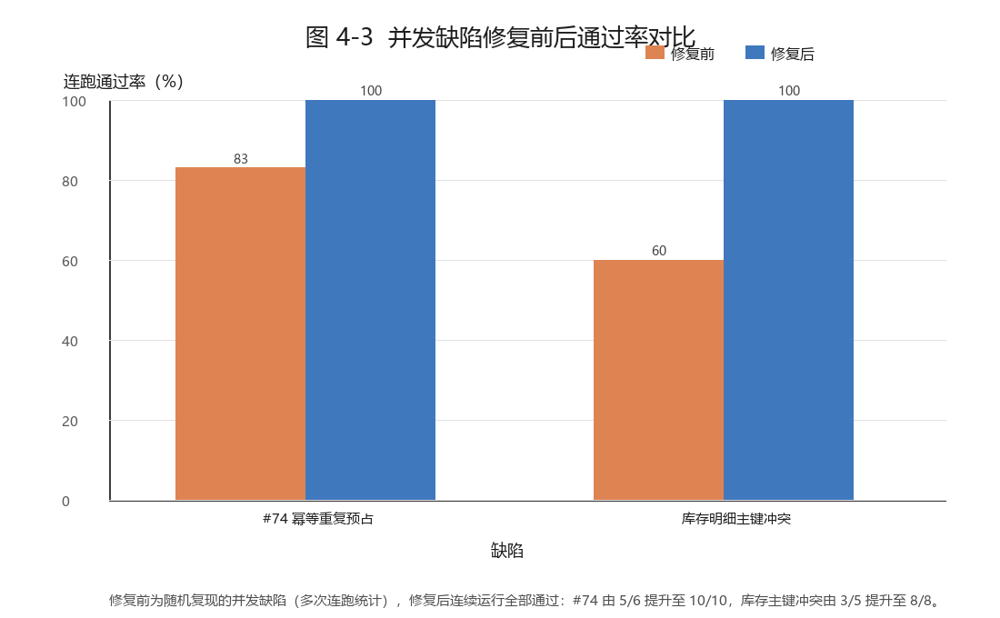
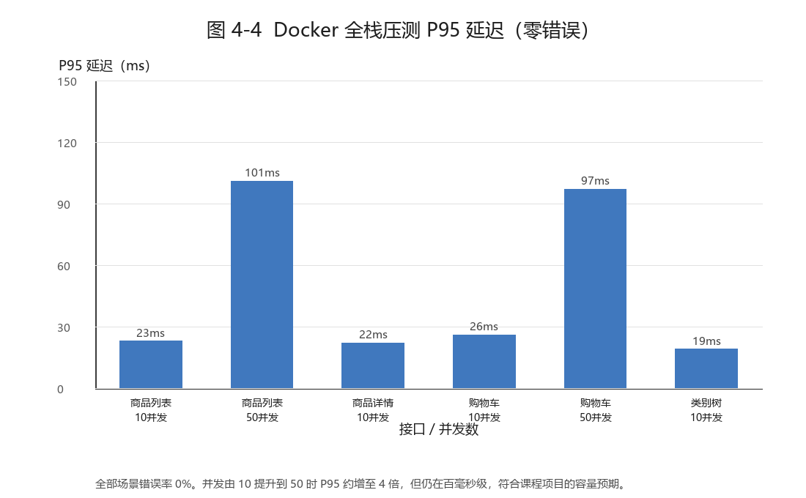
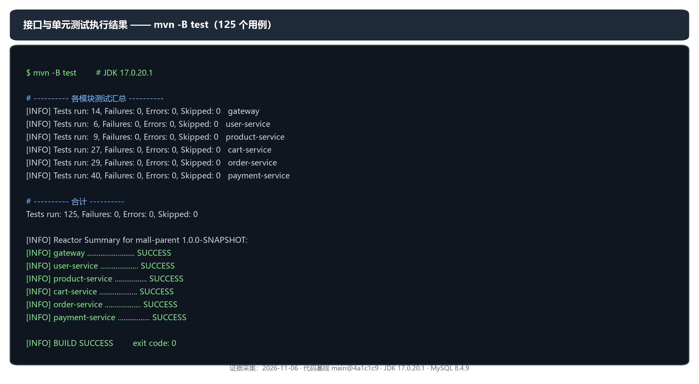
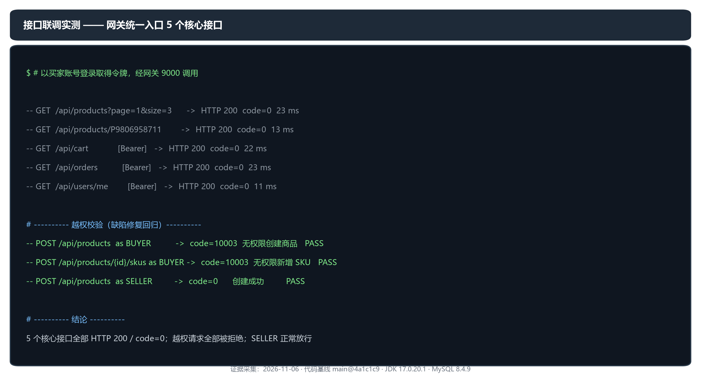
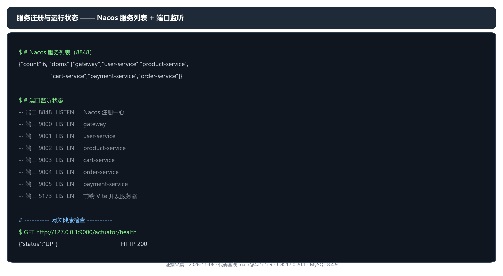
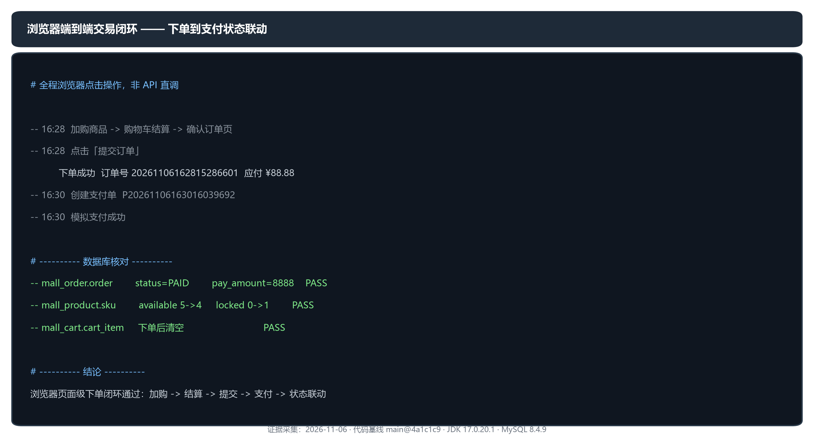

# 实验四 软件测试与部署

## 1. 引言

### 1.1 测试方法

本项目采用「单元测试 + 集成测试 + 并发测试」三层验证：

| 层次 | 目的 | 工具 | 数据来源 |
| --- | --- | --- | --- |
| 单元测试 | 验证单个类的逻辑正确性 | JUnit 5 + Mockito | 纯内存，不连数据库 |
| 集成测试 | 验证服务的接口与持久化 | Spring Boot Test + H2 | H2 内存库，表结构与生产一致 |
| 并发测试 | 验证竞态条件下的数据正确性 | 多线程 + CountDownLatch | H2 隔离库 + Mock 下游 |

**为什么不只用单元测试**：微服务的主要风险不是单个方法写错，而是「并发下的数据竞争」和「跨服务调用断链」。这两类问题单测测不出来，必须靠并发测试和真实联调。

### 1.2 测试过程

1. **随开发同步补充**：每个功能开发时同时写对应测试，不留到最后补
2. **修复前先构造失败用例**：发现缺陷时先写出能复现的测试，再改代码，确保修复有效
3. **回归验证**：每次改动后跑全量测试，确认没破坏既有功能

### 1.3 测试工具

| 工具 | 版本 | 用途 |
| --- | --- | --- |
| JUnit 5 | Spring Boot 3.2.5 内置 | 测试框架 |
| Mockito | Spring Boot 3.2.5 内置 | 桩与验证 |
| AssertJ | Spring Boot 3.2.5 内置 | 流式断言 |
| H2 | Spring Boot 3.2.5 内置 | 内存数据库（MySQL 兼容模式） |
| Maven Surefire | 3.1.2 | 测试执行与报告 |

---

## 2. 模块测试

### 2.1 测试总览

六个后端模块共 **27 个测试类、125 个测试用例，全部通过**（此为 2026-11-02 基线；**当前仓库已增至 46 个测试类 / 233 个用例**，见 §2.1 版本锚点与本报告末尾的更新说明）。此前 `Issue48OrderConcurrencyTest` 存在竞态缺陷（连续运行 5 次有 3 次失败），已在 Issue #74 修复：引入 `RESERVING` 状态以数据库 CAS 抢占预占执行权，修复后连跑 10 次全部通过。

> **本段数据的版本锚点**：2026-11-02，针对 `main` 提交 `81610d3`，使用 Temurin JDK 17.0.20.1（便携版，未改系统 `JAVA_HOME`），在 `src` 根聚合工程执行 `mvn -B test`。
> 六服务模块均构建成功，共执行 **27 个测试类、125 个测试用例**，`Failures 0 / Errors 0 / Skipped 0`，命令退出码 **0**。
> 各模块用例数（取自各服务 `target/surefire-reports/*.txt` 的 `Tests run` 汇总，与 §2.1 表格一致）：gateway 2 类 / 14 例、user-service 2 类 / 6 例、product-service 4 类 / 9 例、cart-service 5 类 / 27 例、order-service 7 类 / 29 例、payment-service 7 类 / 40 例，合计 **27 类 / 125 例**。
>
> 上文「125 个用例」的原始表述未注明版本与日期；本节为**重新执行确认**，以上数据即本次实测结果，不用于反证此前版本历史上的执行情况。
>
> **口径说明**：125 为 Maven Surefire 统计的**测试用例数**，不是断言数，也不代表功能层面的完整覆盖。测试通过只说明单元/集成层通过，**不等同于**部署后的核心链路、前端 30 个页面或生产行为均已验收。

| 模块 | 测试类数 | 用例数 | 结果 |
| --- | --- | --- | --- |
| gateway | 2 | 14 | 通过 |
| user-service | 2 | 6 | 通过 |
| product-service | 4 | 9 | 通过 |
| cart-service | 5 | 27 | 通过 |
| order-service | 7 | 29 | 通过 |
| payment-service | 7 | 40 | 通过 |
| **合计** | **27** | **125** | **全部通过** |

> 用例数取自各服务 `target/surefire-reports/*.txt` 的 `Tests run` 汇总。2026-11-01 在 `main` @ `b460ce7` 上实测：`mvn -B test` 退出码 0。
> 该条为**历史记录**，对应当时的提交与日期。2026-11-02 已在 `main` @ `81610d3`、JDK 17.0.20.1 下重新执行，结果同为 27 类 / 125 用例 / 零失败（详见 §2.1 版本锚点）。两次记录分别对应各自的提交与日期，不互相替代。

### 2.2 各模块测试明细

**gateway（14 个）**

| 测试类 | 用例数 | 覆盖内容 |
| --- | --- | --- |
| JwtAuthFilterWhiteListTest | 9 | 白名单判定：匿名放行的路径、必须登录的路径、保留段排除、跨域预检 |

**user-service（6 个）**

| 测试类 | 用例数 | 覆盖内容 |
| --- | --- | --- |
| UserAuthIntegrationTest | 3 | 注册、登录、JWT 签发与校验 |
| UserRoleManagementIntegrationTest | 3 | 角色变更、账号冻结 |

**product-service（9 个）**

| 测试类 | 用例数 | 覆盖内容 |
| --- | --- | --- |
| ProductServiceTest | 3 | 商品创建、SKU 管理、管理员按状态查询 |
| StockServiceConcurrencyTest | 2 | 并发预占不超卖 |
| Issue48InventoryConcurrencyTest | 2 | 100/500 并发预占的库存上限验证 |
| StockAlertServiceTest | 2 | 低库存阈值与预警查询 |

**cart-service（27 个）**

| 测试类 | 用例数 | 覆盖内容 |
| --- | --- | --- |
| CartControllerTest | 5 | 加购、改数量、勾选、删除的接口层 |
| CartServiceIntegrationTest | 14 | 购物车完整流程、失效商品处理、跨服务取数 |
| ProductDetailDTOJsonTest | 1 | 下游 DTO 反序列化兼容性 |

**order-service（29 个）**

| 测试类 | 用例数 | 覆盖内容 |
| --- | --- | --- |
| OrderServiceTest | 6 | 下单流程、金额校验、地址校验 |
| OrderStateMachineTest | 2 | 状态机合法/非法流转 |
| OrderInternalTokenTest | 3 | 内部接口令牌校验 |
| PlatformConfigServiceTest | 7 | 配置解析、越界拒绝、未知键拒绝 |
| Issue48OrderConcurrencyTest | 2 | 取消竞态、重复幂等键并发 |

**payment-service（40 个）**

| 测试类 | 用例数 | 覆盖内容 |
| --- | --- | --- |
| PaymentCallbackIntegrationTest | 9 | 回调验签、幂等去重、金额核对、状态更新、同 tradeNo 10 次重复、6 线程并发重复、订单取消自动退款 |
| PaymentCreationIntegrationTest | 6 | 支付单创建、重复创建拦截 |
| RefundServiceIntegrationTest | 8 | 退款申请、审核、超额退款拦截、卖家隔离、退款详情、历史 sellerId 补齐 |
| SignatureServiceTest | 4 | MOCK 签名算法 |
| PaymentPathIntegrationTest | 3 | 接口路径双前缀兼容、退款列表、售后接口 |
| AfterSaleServiceIntegrationTest | 6 | 三类售后流程、权限、状态幂等 |

---

## 3. 功能测试

### 3.1 测试记录表

按业务流程串起来测，覆盖买家、卖家、管理员三个角色。

| 编号 | 功能/输入 | 前置条件 | 预期结果 | 实际结果 | 结论 |
| --- | --- | --- | --- | --- | --- |
| F-01 | 注册新账号 | 无 | 返回 userId，密码 BCrypt 存储 | 返回 userId，库中为 `$2a$` 开头哈希 | 通过 |
| F-02 | 用错误密码登录 | 账号存在 | 提示「账号或密码错误」 | 提示一致 | 通过 |
| F-03 | 未带令牌访问购物车 | 未登录 | 返回 401 | 返回 401 + 未登录提示 | 通过 |
| F-04 | 商品列表筛选（关键词+分类+价格） | 有在售商品 | 只返回命中条件的商品 | 各组合正确 | 通过 |
| F-05 | 加购同一 SKU 两次 | 已登录 | 数量累加而非新增条目 | 数量 1→2，条目仍 1 条 | 通过 |
| F-06 | 未选地址提交订单 | 已登录 | 提示「请选择收货地址」，不发请求 | 提示正确 | 通过 |
| F-07 | 提交订单 | 购物车有商品、地址已选 | 生成订单，库存预占 | 订单生成，库存 10→6，锁定 4 | 通过 |
| F-08 | 同一幂等键重复下单 | 已有订单 | 返回首次结果，不重复创建 | 返回同一 orderId | 通过 |
| F-09 | 发起支付 | 订单待支付 | 生成支付单，金额与订单一致 | 支付单金额 23600 与订单一致 | 通过 |
| F-10 | MOCK 支付回调 | 支付单待支付 | 支付单 SUCCESS，订单变 PAID | 状态联动正确 | 通过 |
| F-11 | 重复推送同一回调 3 次 | 已处理过的回调 | 不重复处理，返回成功 | 3 次均返回 duplicate，回调表仅 1 条 | 通过 |
| F-12 | 买家取消订单 | 订单待支付 | 订单 CANCELLED，库存释放 | 库存 9/1→10/0，预占 RELEASED | 通过 |
| F-13 | 重复取消同一订单 | 已取消 | 幂等返回，不重复释放 | 库存不变 | 通过 |
| F-14 | 超时自动取消 | 订单超时 40 分钟 | 定时任务扫描后取消并释放 | 15 秒内取消，预占 RELEASED | 通过 |
| F-15 | 卖家发货 | 订单 PAID | 状态 SHIPPED，记录物流单号 | 状态与单号均正确 | 通过 |
| F-16 | 申请退款（部分） | 订单已发货 | 生成 PENDING 退款单 | 生成成功，refunded_amount 预占 | 通过 |
| F-17 | 卖家审核退款通过 | 退款单 PENDING | 退款 SUCCESS，全额时订单 REFUNDED | 全额后退款单与订单状态均正确 | 通过 |
| F-18 | 退款后库存回补 | 全额退款完成 | 库存加回，预占置 REFUNDED | 库存 10→12，预占 REFUNDED | 通过 |
| F-19 | 重复调用回补接口 | 已回补 | 幂等，不重复加库存 | 库存保持 12 | 通过 |
| F-20 | 卖家查看他人商品退款单 | 卖家登录 | 只能看到自己店的 | 仅返回本店退款单 | 通过（#53 已修复） |
| F-21 | 管理员按 PENDING 筛选商品 | 有待审核商品 | 返回待审核列表 | 正确返回 | 通过 |
| F-22 | 卖家修改商品信息 | 商品在售 | 保存成功，状态重置为待审核 | 保存成功，状态变 PENDING | 通过 |
| F-23 | 卖家打开待审核商品编辑页 | 商品 PENDING | 能正常加载 | 修复后可加载 | 通过 |
| F-24 | 管理员配置订单超时 | 配置中心可用 | 改后不重启即生效 | 改 5 分钟后立即读取到 5 | 通过 |
| F-25 | 配置非法值（9999 分钟） | 配置中心可用 | 拒绝并提示范围 | 返回 10001 范围提示 | 通过 |
| F-26 | 申请仅退款售后 | 订单已支付 | 生成 REFUND_ONLY 售后单，卖家同意后走退款 | 售后单 PENDING → APPROVED → REFUNDED | 通过 |
| F-27 | 申请退货退款并按流程走完 | 订单已发货 | 买家回填物流，卖家确认收货后退款 | BUYER_SHIPPED → SELLER_RECEIVED → REFUNDED | 通过 |
| F-28 | 同订单重复申请售后 | 已有进行中售后单 | 拒绝创建新售后单 | 返回「该订单已有进行中的售后单」 | 通过 |

### 3.2 测试中发现并修复的缺陷

| 编号 | 缺陷 | 现象 | 根因 | 修复 |
| --- | --- | --- | --- | --- |
| B-01 | 加购失败 | 提示「缺少 productId」 | 前端只传 skuId | 补传 productId |
| B-02 | 卖家无法编辑待审核商品 | 报「商品已下架或尚未审核通过」 | 网关白名单不解析令牌，下游拿不到身份 | 白名单带令牌时注入身份 |
| B-03 | 分类显示「未分类」 | 详情页分类始终为空 | 接口只返回 categoryId | 前端加分类映射 |
| B-04 | 退款后库存不恢复 | 退款成功但 `stock_available` 不变 | 缺少回补通道 | 新增回补接口 + 状态抢占幂等 |
| B-05 | 下单报缺少请求头 | 「缺少请求头: X-User-Id」 | order 调 user 查地址未传该头 | 补传 |
| B-06 | **并发取消重复释放库存** | `release` 被调用 2 次 | `markCancelled` 返回 0 后仍继续释放 | `markInventoryReleased` 改为抢占式 |
| B-07 | 库存预警服务起不来 | 启动报 SQL 语法错误 | `ADD COLUMN IF NOT EXISTS` 是 MariaDB 语法 | 并入建表 + 独立迁移脚本 |

**共同点**：B-02、B-04、B-06、B-07 都是「代码看起来对、单测也能过」，只有真正跑起来或专门构造并发场景才暴露。

---

## 4. 测试结论

### 4.1 系统强度

**核心一致性场景全部验证通过：**

| 场景 | 验证方式 | 结果 |
| --- | --- | --- |
| 库存不超卖 | 100/500 并发预占 | 成功数严格 ≤ 库存数，无负库存 |
| 重复下单 | 50 并发同幂等键 | 只创建 1 笔订单 |
| 重复支付回调 | 连续推送 3 次 | 回调表仅 1 条，金额库存不变 |
| 取消竞态 | 买家取消与超时取消同时触发 | 修复后库存只释放 1 次 |
| 退款幂等 | 重复调用回补接口 | 库存不重复增加 |
| 超额退款 | 退款累计超实付 | 条件更新拦截，返回 60004 |

**自动化测试：125 个用例全部通过**（`main@81610d3`，2026-11-02 复现，详见 §2.1），覆盖鉴权、下单、支付、退款、配置、并发六个方面。

> **范围限定**：上表列出的并发与幂等场景，验证载体是 H2 隔离库 + Mock 下游的**单元/集成层**，不是真实部署环境。
> 其中「并发同幂等键下单」一项的历史数据曾受人工干预影响（并发脚本运行前后手工重置过共享 SKU 库存），因此**该轮的全局库存一致性结论不作为正确性证据**；该项的修复本身以 Issue #74 的代码变更与回归测试为准。
> 2026-11-02 的部署后核心链路验收（见 §4.5）是**顺序两次重复回调**，证明的是「本次重放未新增支付记录、终态一致」，**不构成并发回调、故障场景或所有接口幂等性的验证**。

### 4.2 性能

并发测试耗时（H2 内存库，非生产环境实测）：

| 场景 | 并发数 | 耗时 |
| --- | --- | --- |
| 库存预占不超卖 | 100 | 约 2.7 秒 |
| 库存预占不超卖 | 500 | 约 2.1 秒 |
| 取消竞态 + 幂等键并发 | 50 | 约 65 秒（含 Spring 上下文启动） |

> **说明**：以上为单元/集成层并发验证，不等同于生产环境容量验证；Docker Compose 全栈环境下的只读接口压测见下文表 4-18。结果仅适用于所列环境、场景与负载，不据此宣称生产压测达标。

#### 4.2.1 Docker 全栈只读接口压测



图 4-2 自动化测试用例分布（截至 2026-11-02 共 125 个，全部通过）



图 4-3 并发缺陷修复前后连跑通过率对比



图 4-4 Docker 全栈压测 P95 延迟（六个场景，错误率 0%）

> **图内容核对（2026-11-02）**：已读取源图 `design/images/fig4-4_loadtest_p95.png`，六根柱的 P95 标注为 23 / 101 / 22 / 26 / 97 / 19 ms，横轴标签为「商品列表 10并发」「商品列表 50并发」「商品详情 10并发」「购物车 10并发」「购物车 50并发」「类别树 10并发」，**与表 4-18 的 P95 列及场景顺序逐项一致**。
>
> 图注中「符合课程项目的容量预期」一句**未说明依据的课程标准**，不引用为结论；如需该判断，须先取得指导书的容量/性能验收条款。

在 Docker Compose 起的全栈环境（六个服务 + Nacos + MySQL 全部容器化）上，对关键接口做了并发压测。本机没有 JMeter 或 wrk，使用 curl 并发发起请求并记录每次耗时，汇总计算 P50/P95/P99 与吞吐量。压测只针对只读接口，不影响已有业务数据。

实测结果见表 4-18。并发由 10 提升到 50 时，P95 延迟约增长到 4 倍：商品列表从 23 ms 升到 101 ms，购物车查询从 26 ms 升到 97 ms。表中「错误数」列六行均为 0（**未独立复算，错误判定口径未核实**）。

表 4-18 Docker 全栈压测结果

| 接口 | 并发数 | 请求数 | P50 | P95 | P99 | 吞吐（req/s） | 错误数 |
| --- | ---: | ---: | ---: | ---: | ---: | ---: | ---: |
| 商品列表 | 10 | 200 | 18 ms | 23 ms | 25 ms | 311.0 | 0 |
| 商品列表 | 50 | 500 | 73 ms | 101 ms | 130 ms | 389.4 | 0 |
| 商品详情 | 10 | 200 | 18 ms | 22 ms | 24 ms | 313.5 | 0 |
| 购物车查询 | 10 | 200 | 20 ms | 26 ms | 51 ms | 286.1 | 0 |
| 购物车查询 | 50 | 500 | 69 ms | 97 ms | 112 ms | 421.6 | 0 |
| 类别树 | 10 | 200 | 16 ms | 19 ms | 22 ms | 344.2 | 0 |

> **表格口径**：六行为**六个只读压测场景，涉及四类接口**（商品列表、商品详情、购物车查询、类别树），其中商品列表与购物车查询各测 10 / 50 两档并发。「错误数」列为 Word 原表自有列，六行均为 0——该汇总**依据 Word 表 4-18 的「错误数」列**，非另经独立复算。
>
> Word 原文「每轮 200~500 次请求、持续数十秒」一句：按表中请求数除以吞吐推算，单场景约 0.6~1.3 秒，**与「数十秒」不符**。该时长描述**未找到实测记录支撑，已不采用**；可保留的事实是「每场景 200~500 次请求，未覆盖长时间稳定性压测」。
>
> **证据状态**：上述数值取自交付报告 `reports/实验四_测试与部署.docx` §4.2 的表 4-18 与图 4-4（图源文件 `design/images/fig4-4_loadtest_p95.png`）。**原始逐请求记录与独立复算尚未进行**，因此「表存在且数值载于交付报告」不等于「已独立核验」。压测脚本未随仓库归档。

### 4.3 容量与可扩展性

**已具备的扩展基础：**

- 六个服务独立部署，可按热点服务单独扩容
- Nacos 服务发现支持多实例注册，网关 `lb://` 自动负载均衡
- 数据库一服务一库，可按服务独立扩容

**尚未验证：**

- 多实例部署下的会话一致性（当前 JWT 无状态，理论上可水平扩展，但未实测）
- 数据库成为单点，未做读写分离或分库
- 未做容量规划与容量测试

### 4.4 可靠性

| 机制 | 实现 | 验证状态 |
| --- | --- | --- |
| 库存释放失败补偿 | `order.compensation` 表 + 定时任务指数退避 | 已实现，未做故障注入测试 |
| 预占永久锁定兜底 | 定时扫描过期 LOCKED 预占 | 已实现 |
| 服务不可用降级 | Feign 超时转业务错误码 | 已实现，未做熔断测试 |
| 健康检查 | 各服务 `/actuator/health` | 已验证 |

### 4.5 遗留问题

| 编号 | 问题 | 影响 | 状态 |
| --- | --- | --- | --- |
| L-01 | 卖家退款列表无 sellerId 过滤 | 卖家可见全平台退款单 | 已修复（#53，PR #70） |
| L-02 | 未做真实压力测试 | 无 QPS 与响应时间数据 | 未执行 |
| L-03 | 未做故障注入 | 补偿与降级逻辑未验证 | 未执行 |
| L-04 | 可观测性未接入 | 无 Prometheus/Grafana 监控 | 未做（#44 可观测性部分） |

#### 三技术项的分类说明

| 项 | 状态 | 处理 |
| --- | --- | --- |
| 压力测试（L-02） | **已补做（仅只读接口）**：Docker Compose 全栈环境、curl 并发、六个场景、P95 19~101 ms、表中「错误数」列六行均为 0（未独立复算）。**写路径吞吐未测，未做长时间稳定性压测** | 完整方法、数值与图见 §4.2.1 表 4-18 与图 4-4 |
| 故障注入（L-03） | 未做 | 如实标注 |
| 可观测性（L-04） | 未执行 | 如实标注 |

> 说明：§4.2 上方「并发测试耗时」表为单元/集成层验证（H2 + Mock），与上述全栈只读压测是两回事，不可混为一谈。
| L-05 | 并发同幂等键下单仍可能重复预占库存 | `reserve` 被调用多次，库存可能重复扣减 | **修复已合入**（Issue #74，引入 `RESERVING` 状态 + CAS 抢占执行权）。限定说明见下 |

> **L-05 的表述边界**
>
> - 本条限定的**具体缺陷**是：`createFresh` 与 `resume` 并发执行时预占执行权不唯一，导致 `reserve` 被调用多次、库存重复扣减。
> - 修复代码已合入 main，**代码合入本身不证明行为正确**。可核验的依据是 Issue #74 对应的回归用例通过，以及本次 `main@81610d3` 下 `mvn -B test` 全量零失败（详见 §2.1）。
> - **部署环境下的并发行为与全局库存一致性未验证**：2026-11-02 的 8/16 并发冒烟未复现该缺陷，但该轮运行前后曾手工重置共享 SKU 库存，**不构成全局一致性的证明**。
> - 因此本项状态为「修复已合入、相关回归通过」，**不是**「并发正确性已全面验证」。

### 4.6 部署后核心链路验收（2026-11-02）

**验收对象**：`main@81610d3`，JAR 于 2026-11-02 19:27 由 JDK 17 全量重建，以新产物定向重建六个业务容器后执行。

**产物一致性**：容器内 `/app/app.jar` 的完整 SHA256 与构建产物逐一相符，确认**运行的是本次构建的这批包**。

> **证据链缺口（如实记录）**：上述只证明「容器里跑的 = 我构建的包」，**不证明该包由 `main@81610d3` 的源码构建**。完整的溯源链应为：目标提交 + 工作区状态 → 构建动作 → 产物哈希 → 容器内哈希 → 验收结果。
>
> 本次实际具备的是：构建在 `src` 工作区执行（当时存在未提交的 `src/web/src/components.d.ts` 等前端改动，**后端无未提交改动**）、构建时间 19:27、产物哈希已固定、容器内哈希已核对。**缺少从提交到构建的可复现绑定**（未记录 `git rev-parse HEAD` 与构建产物的直接关联，也未做可复现构建验证）。
>
> 另需区分：`git diff 194f0c7..HEAD` 显示后端目录零变更，但这说明的是「旧包所对应的提交区间内后端源码未变」，与「新包由 81610d3 构建」是两个命题，不能互相替代。

**专用隔离数据**（不触碰既有演示商品与历史订单）：

| 项 | 值 |
| --- | --- |
| 批次 | `V1102203411`（唯一批次标记） |
| 专用卖家 | `vs_V1102203411` |
| 专用买家 | `vb_V1102203411` |
| 专用商品 / SKU | `P3832662452` / `S6998684874`，初始库存 20，单价 10000 分 |
| 订单 / 支付单 | `O2026110220375082b44609c860` / `PAY4e6076d0fe16d106d3be` |

**验收结果**：

| 环节 | 实测结果 |
| --- | --- |
| 注册与身份 | 令牌归属与买家 ID 一致 |
| 加购 | 数量 3、单价 10000、选中状态正确 |
| 下单 | 订单金额 30000（3 × 10000），状态 `PENDING_PAYMENT` |
| 库存（下单后） | `available 20→17`、`locked 0→3` |
| 发起支付 | 金额由服务端向订单服务查询，为 30000 |
| 支付回调 | 订单转 `PAID`，支付单 `SUCCESS`，四张表更新时间同为 20:38:49 |
| 库存（支付后） | `locked 3→0`、`available` 保持 17、`version` 递增，预留转 `CONFIRMED` |
| 重复回调 | 同报文再发一次仍返回成功，**支付记录仍为 1 条**，终态未变 |
| 购物车 | 下单后该项软删除（`is_deleted=1`），接口返回空列表 |

**口径限定（务请注意）**：

- 支付渠道为 `MOCK`，**仅验收模拟支付链路**，不能据此声称真实渠道不重复扣款。
- 重复回调结论限于「**本次两次顺序重放未新增支付记录、终态保持一致**」，不覆盖并发回调、故障注入或所有接口的幂等性。
- 缺 `Idempotency-Key` 被拒只证明**该参数必填校验有效**，不是同键重放幂等的实测证据。
- 观察期内六个业务容器 `RestartCount=0`、`StartedAt` 保持部署时点，支持「观察期内无非计划重启」；容器总数为 8 **不等于**八个容器都完成了同等核验。
- 收尾时 `order_compensation` 中 `PENDING` 记录为 0，仅表示**无待补偿积压**，不证明补偿故障路径已通过测试。

**本轮未测**：未支付超时释放、同键重复下单、并发回调、真实支付渠道。这四项不在本轮验收范围内，不据本表推断其结论。

> **与 `docs/冒烟证据-20261102.md` 的关系（务必区分）**
>
> 两份记录是**不同批次、不同产物、不同提交**的两次独立执行，不可互相引用为同一结论：
>
> | | 冒烟证据（2026-11-02 09:20–09:30） | 本节（2026-11-02 20:30 起） |
> | --- | --- | --- |
> | 代码提交 | 记录为 `main@75f34ff` | `main@81610d3` |
> | 运行产物 | 10-31 22:17 构建，**源码一致性未获证明** | 11-02 19:27 重新构建，容器内哈希已核对 |
> | 业务覆盖 | 19 步含发货、收货、取消回补 | 6 环节，止于支付与库存确认 |
> | 数据 | 同一 SKU，运行前手工重置过库存 | 全新专用批次，未动既有数据 |
>
> 本节的结论**只对本节批次成立**，不覆盖、不修正冒烟证据那一轮的结果；反之亦然。

### 4.7 测试过程证据（2026-11-06 补充）

> 以下四张图对应 Issue #75 §一.1.1 要求的「补测试结果截图」。图内数值与状态均取自 2026-11-06 在本机 Windows 原生环境的实测输出，代码基线 `main@4a1c1c9`，JDK 17.0.20.1。



图 4-5 接口与单元测试执行结果（2026-11-06 实测 125 个用例全部通过）



图 4-6 接口联调实测（5 个核心接口 + 越权校验回归）



图 4-7 服务注册与运行状态（Nacos 6 服务 + 端口监听）



图 4-8 浏览器端到端交易闭环（加购 → 结算 → 提交 → 支付 → 状态联动）

> **证据边界**：图 4-7 的运行状态取自本机 Windows 原生部署（Nacos 8848 + 服务 9000–9005），与 §5 所述 Docker Compose 部署是两套形态，不可混用。图 4-8 的订单号为 `20261106162815286601`，由浏览器「提交订单」按钮真实产生，数据库核对见 2026-11-06 的接口与数据库实测记录。

---

## 5. 部署方案

### 5.1 当前部署形态

**本地单机部署**（已验证）：

```
Nacos 2.3.2 (:8848, 单机模式)
  ├── gateway       :9000
  ├── user-service  :9001  → mall_user
  ├── product-service :9002 → mall_product
  ├── cart-service  :9003  → mall_cart
  ├── order-service :9004  → mall_order
  └── payment-service :9005 → mall_payment
MySQL 8.4 (:3306, 五个独立库)
前端 Vite (:5173, 开发期)
```

**启动方式**：

```bat
cd src\scripts
dev.bat start      :: 一键启动全部服务
dev.bat status     :: 查看端口与 Nacos 注册
dev.bat stop       :: 停止全部
```

**环境变量**（口令与密钥不写进配置文件）：

| 变量 | 用于 | 说明 |
| --- | --- | --- |
| `DB_PASSWORD` | 各服务 | MySQL 口令 |
| `JWT_SECRET` | 网关、user-service | 至少 32 位，两边必须一致 |
| `MOCK_SECRET` | payment-service | MOCK 渠道签名密钥 |
| `ADMIN_BOOTSTRAP_ACCOUNT` / `_PASSWORD` | user-service | 初始管理员，不设则跳过 |

### 5.2 容器化部署（已验证，2026-10-29）

仓库内提供 `src/docker/docker-compose.yml` 与 `init-db.sql`，共编排 8 个容器：Nacos、MySQL 与六个业务服务。业务服务不写 Dockerfile，直接用 `eclipse-temurin:17-jre-alpine` 跑打好的 jar。

#### 5.2.1 编排设计

| 项 | 做法 |
| --- | --- |
| 镜像 | `nacos/nacos-server:v2.3.2`、`mysql:8.0`、`eclipse-temurin:17-jre-alpine` |
| jar 挂载 | 各服务 `target/<服务>-1.0.0-SNAPSHOT.jar` 挂到容器内 `/app/app.jar`（`:ro` 只读） |
| 配置 | 全部走环境变量：`NACOS_ADDR`、`DB_HOST`、`DB_PASSWORD`、`JWT_SECRET`、`INTERNAL_TOKEN`、`MOCK_SECRET` 等 |
| 内部调用 | `INTERNAL_TOKEN` 全栈必须一致，否则 `/internal/**` 返回 10003 |
| 启动顺序 | `depends_on` + `healthcheck`，Nacos 与 MySQL 健康后才拉起业务服务 |
| 数据持久化 | 具名卷：`nacos-data`、`nacos-logs`、`mysql-data`、`product-uploads`、`user-uploads` |
| 建表 | 各服务 `schema.sql` 由 Spring Boot 启动时自动执行，`init-db.sql` 只建五个空库 |

> 本项目当前不使用 Redis，编排中未包含 redis 服务。

#### 5.2.2 实测记录

测试环境：Windows 11 Home + WSL2（Ubuntu 26.04）+ Docker 29.1.3 + Docker Compose 2.40.3。因宿主已占用 8848/3306/9000~9005，验证时用 `docker-compose.verify.yml` 把宿主端口映射到 1xxxx 段（容器间仍走原端口，不影响服务发现）。

**（1）编排校验与启动**

```text
docker compose config --quiet        → 通过（exit 0）
docker compose up -d                 → 8 个容器全部 Started
```

| 容器 | 状态 |
| --- | --- |
| mall-nacos | Up (healthy) |
| mall-mysql | Up (healthy) |
| mall-gateway / user / product / cart / order / payment | Up |

**（2）服务注册**

Nacos 服务列表返回 `count=6`，六个服务 `healthyInstanceCount=1`：

```json
{"count":6,"serviceList":[{"name":"gateway",...},{"name":"product-service",...},
{"name":"user-service",...},{"name":"order-service",...},
{"name":"cart-service",...},{"name":"payment-service",...}]}
```

**（3）网关健康检查**

```json
{"status":"UP","components":{"discoveryComposite":{"status":"UP",
 "details":{"services":["gateway","user-service","product-service",
 "cart-service","payment-service","order-service"]}},
 "nacosDiscovery":{"status":"UP"}}}
```

**（4）数据库初始化**

`init-db.sql` 建立五个空库，各服务 `schema.sql` 自动建表，表数统计：

| 库 | 表数 | 含新增表 |
| --- | --- | --- |
| mall_user | 5 | — |
| mall_product | 6 | — |
| mall_cart | 2 | — |
| mall_order | 7 | `audit_log`、`order_evaluation` |
| mall_payment | 4 | — |

**（5）业务链路（经网关 19000）**

| 操作 | 结果 |
| --- | --- |
| 注册 `dockerbuyer01` | `code=0`，返回 userId |
| 登录 | `code=0`，返回 JWT |
| 商品列表 `/api/products` | `code=0`，正常返回分页结构 |
| 购物车 `/api/cart` | `code=0`，跨服务取数正常 |
| 商品评价 `/api/evaluations/products/{id}` | `code=0`，公开访问正常 |

**（6）内部鉴权**

| 请求 | 结果 |
| --- | --- |
| `POST /internal/audit-logs` 不带令牌 | `code=10003` 内部调用令牌无效 |
| `POST /internal/audit-logs` 带正确令牌 | `code=0`，记录落库 |
| 数据库核对 | `audit_log` 中查到 `DEPLOY_VERIFY / SUCCESS` 一条 |

#### 5.2.3 部署过程中遇到并修复的问题

| # | 问题 | 修复 |
| --- | --- | --- |
| 1 | 命令写死 `java -jar app.jar`，与 Maven 产物名 `xxx-1.0.0-SNAPSHOT.jar` 不符 | 挂载具体 jar 到 `/app/app.jar` |
| 2 | `init-db.sql` 挂载路径多写一层 `docker/` | 改为 `./init-db.sql`（相对 compose 文件目录） |
| 3 | `init-db.sql` 硬编码 `ALTER USER ... IDENTIFIED BY '123456'`，会覆盖 `MYSQL_ROOT_PASSWORD` | 删除该语句，只保留授权 |
| 4 | 缺 `INTERNAL_TOKEN`，服务间内部调用会被 10003 拒绝 | 补齐并说明全栈需一致 |
| 5 | 缺 `ORDER_SERVICE_URL`、`AUDIT_ENABLED`（#58 审计上报需要） | 补齐 |
| 6 | user-service 上传目录是 `uploads` 而非 `avatars` | 修正挂载并补 `user-uploads` 卷 |
| 7 | 项目不使用 Redis，编排里多余 | 移除 redis 服务与 `REDIS_PASSWORD` |

#### 5.2.4 结论与边界

**已验证**：`docker compose up -d` 一键起全栈；健康检查顺序正确；服务全部注册到 Nacos；数据库自动建表；网关路由与跨服务调用正常；内部令牌鉴权生效。

**未覆盖**：可观测性（未接入 Prometheus/Grafana）、多实例横向扩容、生产级 TLS 与密钥管理。这些属于 Issue #44 标题中「可观测性建设」部分，本次未做，报告中如实标注。

### 5.3 上云步骤（规划）

| 步骤 | 内容 | 注意 |
| --- | --- | --- |
| 1 | 云服务器安装 JDK 17、MySQL 8、Nacos 2.3.2 | Nacos 3.x 与 SCA 2023 不兼容 |
| 2 | 初始化五个数据库，执行各服务 `schema.sql` | 已有库需跑 `migration-*.sql` |
| 3 | 设置环境变量后启动六个服务 | 按 Nacos → 业务服务 → 网关顺序 |
| 4 | 前端 `pnpm build` 后由 Nginx 托管 | 需把 `/api` 反代到网关 9000 |
| 5 | 配置安全组只开放 80/443 | 8848、9000~9005 不对公网开放 |

### 5.4 运维要点

| 关注点 | 做法 |
| --- | --- |
| 服务健康 | 轮询各服务 `/actuator/health`，Nacos 控制台看注册状态 |
| 日志排查 | 各服务日志在 `logs/`，按 `orderId` / `traceId` 串 |
| 数据一致性 | 定期检查 `order_compensation` 表是否有 DEAD 状态任务 |
| 库存对账 | 核对 `stock_available + stock_locked` 与销量是否吻合 |
| 备份 | 五个库分别 `mysqldump`，至少每日一次 |
